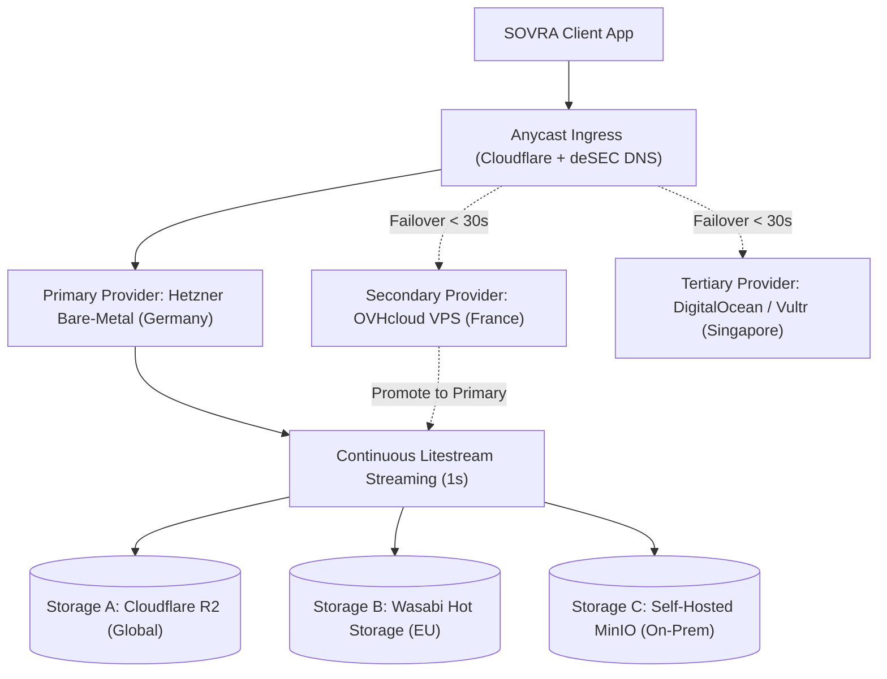

# SOVRA — MULTI-PROVIDER DEPLOYMENT & HIGH-AVAILABILITY PLAN

> **Standard:** Multi-Cloud Zero-Lock-In Infrastructure Architecture  
> **Status:** Phase 0 Architecture Deliverable  
> **Repository Commit:** `6306538` | **Date:** 2026-11-05  

---

## 1. System High-Availability Topology

To ensure zero single points of failure across infrastructure vendors, SOVRA operates across three distinct tiers of hosting providers spanning separate legal jurisdictions:



---

## 2. Multi-Provider Deployment Matrix

| Role | Primary Provider | Secondary Backup Provider | Tertiary Emergency Provider | Disaster Migration Trigger |
|:---|:---|:---|:---|:---|
| **Static Web App & Assets** | Cloudflare Pages (Free, unmetered requests) | GitHub Pages (Free, 100 GB/mo) | Direct Caddy Reverse Proxy on Bare-Metal VPS | Cloudflare account warning or commercial policy change. |
| **Ingress & TLS Proxy** | Caddy 2 on Hetzner VPS (`docker/Caddyfile`) | Caddy 2 on OVHcloud VPS | Caddy 2 on DigitalOcean droplet | Primary host ping failure for $> 15\text{ seconds}$. |
| **API Gateway & Core Node** | Container on Hetzner Bare-Metal | Container on OVHcloud | Container on Oracle Cloud Always Free VM | Host kernel panic or hardware failure. |
| **Database WAL Replication** | Cloudflare R2 (10 GB free forever) | Wasabi Object Storage (\$6/mo) | Independent Self-Hosted MinIO cluster | R2 quota exceeded or API credential invalidation. |
| **Authoritative DNS** | Cloudflare Authoritative DNS | deSEC.io (Berlin, Germany) | Hurricane Electric Free DNS (Fremont, CA) | TLD hijacking, registrar lock, or provider DDoS. |
| **Blockchain Validator** | Dedicated bare-metal host (Zürich) | Standby sentry host (Frankfurt) | Standby validator node (Tokyo) | Primary missed pre-commit count $> 10$ consecutive blocks. |

---

## 3. Clean-Slate Deployment Runbook (From Scratch)

To provision a fully functional SOVRA node on an empty Debian 12 or Ubuntu 22.04 LTS host without prior configuration:

```bash
# Step 1: Execute idempotent turnkey installer
curl -fsSL https://raw.githubusercontent.com/ewanbabu36-cell/sovra/main/deploy/install.sh | sudo bash

# Step 2: Clone repository to standard directory
git clone https://github.com/ewanbabu36-cell/sovra.git /opt/sovra
cd /opt/sovra

# Step 3: Configure production secrets
cp .env.example .env.production
ADMIN_KEY=$(openssl rand -hex 32)
THROTTLE_KEY=$(openssl rand -hex 32)
sed -i "s/ADMIN_SECRET_KEY=.*/ADMIN_SECRET_KEY=${ADMIN_KEY}/" .env.production
sed -i "s/SOVRA_THROTTLE_SECRET=.*/SOVRA_THROTTLE_SECRET=${THROTTLE_KEY}/" .env.production

# Step 4: Launch containerized multi-service stack
docker compose -f docker/docker-compose.production.yml --env-file .env.production up -d --build

# Step 5: Verify health & readiness
curl -f http://localhost:3001/livez
curl -f http://localhost:3001/readyz
curl -f http://localhost:3001/api/status
```

---

## 4. Multi-Provider Failover & Rollback Protocols

### 4.1 Automated Gateway Failover Procedure
1. **Health Prober Detection:** External probers detect primary gateway non-responsiveness ($> 5\text{s}$) on `/livez`.
2. **Database Promotion on Secondary Host:**
   ```bash
   ssh admin@backup.sovra.ovh
   litestream restore -v -config /etc/litestream.yml -o /app/.sovra-storage-prod/sovra-social.sqlite
   docker compose -f /opt/sovra/docker/docker-compose.production.yml up -d
   ```
3. **DNS Anycast Routing Shift:** Automated OctoDNS sync updates A-records to secondary IP.
4. **Estimated Down Time:** Total transition $< 45\text{ seconds}$; RPO $< 1.0\text{ second}$.

### 4.2 Application Rollback Procedure
If a newly deployed container version fails the `/readyz` probe:
1. Caddy upstream automatically keeps proxying traffic to the existing stable container on port 3001.
2. If database migrations must be reverted, run:
   ```bash
   node scripts/database-migrations.ts --rollback
   ```
3. Docker Compose restarts the previous image tag (`sovra/network-node:previous`).
