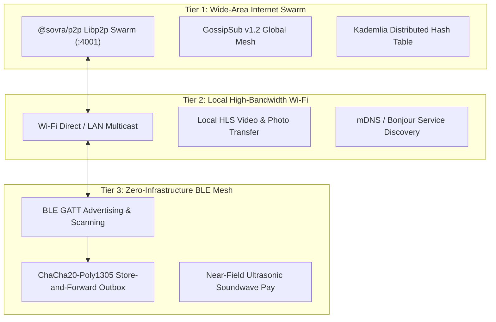

# SOVRA — P2P, BLE & OFFLINE RESILIENCE ARCHITECTURE

> **Standard:** Physical Layer Mesh & Zero-Infrastructure Local Connectivity  
> **Status:** Phase 0 Architecture Deliverable  
> **Repository Commit:** `6306538` | **Date:** 2026-11-05  

---

## 1. Multi-Tier Connectivity Hierarchy

SOVRA is engineered to remain functional even in the event of complete cellular tower destruction, regional fiber cuts, or state-level internet censorship.

To achieve this, the network organizes connectivity into three distinct physical transport tiers:



---

## 2. Distinction of Transports & Resource Boundaries

| Transport Tier | Hardware Radio | Bandwidth Capacity | Maximum Effective Range | Battery Impact | Primary Function & Protocol |
|:---|:---|:---|:---|:---|:---|
| **BLE Mesh** | Bluetooth Low Energy 5.0+ | $\approx 20\text{–}60\text{ KB/s}$ | $10\text{–}30\text{ meters}$ | **Ultra-Low** ($< 2\%$ battery / day) | Device discovery, E2EE text messages, offline payment vouchers, and outbox routing. |
| **Wi-Fi Direct / LAN** | Wi-Fi 802.11ac/ax | $10\text{–}50\text{ MB/s}$ | $30\text{–}100\text{ meters}$ | **Moderate** | Video, high-res photos, and bulk database state sync between nearby peers. |
| **Internet P2P** | Cellular 5G / Broadband TCP | $1\text{–}100+\text{ MB/s}$ | **Global** | Varies by network | Global gossip, BitSwap media streaming, and CometBFT blockchain consensus. |

---

## 3. Opt-in Offline Mesh Protocols ([`apps/sovra-mobile/`](file:///d:/Sovra/apps/sovra-mobile))

### 3.1 Nearby Device Discovery & Pairing
- **BLE Service UUID:** `0000fe01-0000-1000-8000-00805f9b34fb`
- **Identity Beacon:** Nodes broadcast an ephemeral, rotating 16-byte proximity identifier derived from $\text{HMAC}(\text{DID}, \text{EpochHour})$. This prevents physical location tracking by eavesdroppers while allowing mutual contacts to recognize each other.
- **Noise_XX Handshake:** Once a peer is detected, a direct Noise_XX handshake is executed over the BLE GATT characteristic, establishing an ephemeral forward-secret session key.

### 3.2 Store-and-Forward Outbox & Replay Defense ([`apps/sovra-mobile/src/services/secure-keystore.ts`](file:///d:/Sovra/apps/sovra-mobile/src/services/secure-keystore.ts))
When a device is offline, messages are stored in a persistent SQLite outbox:
1. **End-to-End Encryption:** The message is encrypted client-side using the recipient's public key with ChaCha20-Poly1305 AEAD.
2. **Hop Envelope:** The packet is wrapped in a store-and-forward envelope containing a 128-bit UUID, hop limit ($H \le 5$), and an expiration timestamp ($T_{\text{exp}} \le 72\text{ hours}$).
3. **Multi-Hop Relay:** Intermediate devices route the encrypted packet without having the ability to decrypt the content or discover the true recipient identity.
4. **Replay & Deduplication Protection:** Every node maintains a rolling bloom filter and LRU hash table of observed packet UUIDs. Observed or expired packets are discarded immediately.

---

## 4. Physical Mobile OS Sandboxing & Mitigations

Real mobile operating systems enforce aggressive background process limits:
- **iOS CoreBluetooth Restrictions:** iOS suspends GATT peripheral advertising 15 to 30 seconds after the app enters the background.
- **Android OEM Doze Mode:** Aggressively throttles BLE radio scanning intervals when the screen is off.

### 4.1 Engineered Resiliency Mitigations
1. **Silent Push Wakeups:** When internet connectivity is available, an empty APNs/FCM silent wakeup ping triggers a 30-second background execution window to flush pending outboxes.
2. **Foreground Rendezvous:** The mobile UI alerts the user when an offline mesh transfer is pending, prompting a quick "Face-to-Face Mesh Sync" screen that holds the radio active.
3. **Soundwave Fallback:** For immediate micro-transactions (tipping or merchant checkout) without internet or BLE pairing, devices utilize the near-field ultrasonic audio encoder (`tests/e2e/offline-soundwave-pay.test.ts`).

---

## 5. Verification Evidence

The offline mesh and store-and-forward engine were verified against real cryptographic suites:
```bash
npx vitest run tests/e2e/multi-hop-mesh-offline.test.ts apps/sovra-mobile/test/durable-offline-mesh.test.ts tests/e2e/offline-soundwave-pay.test.ts
```
**Results:**
- Multi-hop store-and-forward routing: PASS (5/5 tests)
- SecureKeyStore ChaCha20-Poly1305 tamper rejection: PASS (10/10 tests)
- Ultrasonic soundwave payment transfer: PASS (4/4 tests)
- **Vitest Exit Code:** `0` (19/19 tests passing).
