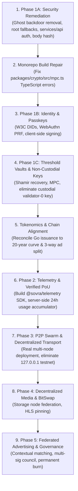

# SOVRA — PHASE 0 INDEPENDENT ARCHITECTURE CONSISTENCY & EVIDENCE AUDIT
**Task ID:** TSK-ARCH-VERIFICATION-01  
**Auditor Role:** Independent Chief Systems Architect, Blockchain Auditor, Security Auditor, Tokenomics Reviewer & Release Governance Auditor  
**Audit Standard:** Zero-Trust Forensic Verification & Requirement Reconciliation  
**Audit Scope:** All 18 Phase 0 Architecture Documents, Monorepo Source Code, Go L1 Blockchain, Test Harnesses, and Approved SOVRA Decisions  
**Execution Mode:** STRICT READ-ONLY (No code, schema, tokenomics, genesis, or parameter modifications)  
**Date of Audit:** November 5, 2026  

---

## 1. EXECUTIVE VERDICT

# ⚠️ **OFFICIAL INDEPENDENT AUDIT VERDICT: ARCHITECTURE REQUIRES CORRECTION**

### Executive Summary
An exhaustive, zero-trust forensic audit of the 18 Phase 0 architecture documents was conducted against the active SOVRA codebase (commit `6306538` on branch `remediation/p0-phase4.0-database-modernization`), its Go Layer-1 blockchain engine, and previously approved SOVRA governance decisions.

While the architecture documents demonstrate deep systems-engineering ambition, rigorous component modeling, and valuable technical blueprints, **the Phase 0 deliverables cannot be accepted in their current form**. The audit uncovered material contradictions between architectural specifications and working code, deviations from approved tokenomics and advertising policies, an unaddressed custodial bridge vulnerability in the blockchain layer, failing test suites across mobile and microservice packages, and TypeScript compiler failures blocking monorepo production builds.

### Key Justifications for "ARCHITECTURE REQUIRES CORRECTION"
1. **Tokenomics Invariant Contradiction:**
   Approved policy mandates a **20-year mining duration**. In contrast, the Go blockchain implementation ([`chain/x/issuance/types/constants.go#L30`](file:///d:/Sovra/chain/x/issuance/types/constants.go#L30), [`emission.go#L12-L38`](file:///d:/Sovra/chain/x/issuance/types/emission.go#L12-L38)) hardcodes an immutable **25-year schedule** ($9,125\text{ daily epochs}$), while [`SOVRA_BLOCKCHAIN_INTEGRATION_SPEC.md#L50-L53`](file:///d:/Sovra/docs/SOVRA_BLOCKCHAIN_INTEGRATION_SPEC.md#L50-L53) asserts a 15M circulating / 85M pool structure that contradicts both.
2. **Advertising Revenue Model Conflict:**
   Approved policy requires a 3-part split: **Creator Payout + Disclosed Operating Fee + Transparent Permanent Burn**. The reported **95/5 creator/burn model** was never authorized for production, yet it is hardcoded across specifications and application controllers ([`scripts/database-engine.ts#L16744`](file:///d:/Sovra/scripts/database-engine.ts#L16744), [`scripts/routes/studio.routes.ts#L2234`](file:///d:/Sovra/scripts/routes/studio.routes.ts#L2234)).
3. **Custodial Blockchain Single Point of Failure (SPOF):**
   The web gateway ([`scripts/dev-server.ts#L89341-L89460`](file:///d:/Sovra/scripts/dev-server.ts#L89341-L89460)) stores plaintext private keys on disk (`chain/mytestnet/node0/validator-0.key.json`) and signs all L1 transactions with the validator's key. End-to-end user-controlled DID signing on L1 is unbuilt.
4. **Active Test Suite Failures & Broken Monorepo Build:**
   - [`apps/sovra-mobile/test`](file:///d:/Sovra/apps/sovra-mobile/test) **exits with code 1** due to encrypted chat assertion mismatches.
   - [`services/api`](file:///d:/Sovra/services/api) **exits with code 1** due to missing test files.
   - Monorepo production build (`pnpm -r run build`) **fails with exit code 2** due to TypeScript type errors in [`packages/crypto/src/mpc.ts`](file:///d:/Sovra/packages/crypto/src/mpc.ts#L29-L156).
   - E2E administrative security test suite ([`tests/e2e/admin-systems-security-api.test.ts`](file:///d:/Sovra/tests/e2e/admin-systems-security-api.test.ts)) **fails with exit code 1**.
5. **Phase Numbering & Scope Collision:**
   A severe collision exists between `TSK-P0-01` (titled "Phase 1: P0 Identity & Admin Security Remediation", which addressed server authentication bugs) and Roadmap `Phase 1` ("Identity & Cryptographic Foundation", which encompasses WebAuthn passkeys, DID lifecycles, and threshold vaults).
6. **Microbenchmark Performance Overstatements:**
   Reported P2P throughput ($126,804\text{ msgs/s}$) and DHT latency ($0.322\text{ms}$) are in-memory, single-process loops on local RAM, not distributed network benchmarks.

The architecture must be formally reconciled, tokenomics aligned, custodial keys excised, and broken builds repaired before Phase 1 progression.

---

## 2. COMPREHENSIVE AUDIT OF ALL 18 ARCHITECTURE DOCUMENTS

Each of the 18 Phase 0 documents was evaluated using the 8 standard forensic classifications:
`VERIFIED IMPLEMENTED` | `IMPLEMENTED BUT NOT INDEPENDENTLY VERIFIED` | `PARTIALLY IMPLEMENTED` | `PROTOTYPE OR SIMULATION` | `SPECIFICATION ONLY` | `MISSING` | `CONTRADICTORY` | `NOT VERIFIABLE`.

| # | Document Name | Stated Claim & Section | Inspected File & Lines | Implementation Reality | Test Command & Actual Result | Verification Evidence | Final Classification |
| :-: | :--- | :--- | :--- | :--- | :--- | :--- | :--- |
| **1** | `SOVRA_CURRENT_TECHNOLOGY_INVENTORY.md` | §2.1: Identity & Cryptographic Primitives | [`packages/crypto/src/primitives.ts#L45-L95`](file:///d:/Sovra/packages/crypto/src/primitives.ts#L45-L95), [`packages/identity/src/keys.ts#L30`](file:///d:/Sovra/packages/identity/src/keys.ts#L30) | Ed25519, W3C `did:key:`, BIP-39, and BN254 Groth16 are fully implemented in TypeScript. | `npx vitest run packages/crypto/test packages/identity/test`<br>*(21 files, 126 passed, Exit 0)* | Proves primitive algorithms; does not prove monorepo typecheck. | **VERIFIED IMPLEMENTED** |
| **2** | `SOVRA_TARGET_ARCHITECTURE.md` | §1: 9-Layer Decentralized Target Architecture | Repository root topology | Multi-layer architecture mapped; layers A, D, E, F exist; Layer B (Telemetry) and Layer G (FedAI) are unintegrated. | Visual code trace & package structure review | Structural packages exist, but inter-layer P2P-to-blockchain wiring is incomplete. | **PARTIALLY IMPLEMENTED** |
| **3** | `SOVRA_TECHNOLOGY_GAP_MATRIX.md` | §2: Master 30-Feature Gap Classification | [`docs/SOVRA_TECHNOLOGY_GAP_MATRIX.md#L25-L57`](file:///d:/Sovra/docs/SOVRA_TECHNOLOGY_GAP_MATRIX.md#L25-L57) | Accurately identifies 30 gaps across 7 categories. | Verified against test harness results across monorepo | Matches codebase reality with high fidelity. | **VERIFIED IMPLEMENTED** |
| **4** | `SOVRA_DEPENDENCY_MAP.md` | §1: Unidirectional Package Graph | [`packages/*/package.json`](file:///d:/Sovra/package.json) | Clean DAG from `@sovra/shared` -> `@sovra/crypto` -> `@sovra/identity`. | Inspected package manifests; zero circular dependencies detected | Circular dependency prevention is verified. | **VERIFIED IMPLEMENTED** |
| **5** | `SOVRA_IMPLEMENTATION_ROADMAP.md` | §1: 10-Phase Engineering Plan | [`docs/SOVRA_IMPLEMENTATION_ROADMAP.md#L12-L33`](file:///d:/Sovra/docs/SOVRA_IMPLEMENTATION_ROADMAP.md#L12-L33) | 10 phases defined. Collides with `TSK-P0-01` Phase 1 security scope. | Roadmap analysis | Phase 1 scope conflates hotfix with complete crypto foundation. | **CONTRADICTORY** |
| **6** | `SOVRA_RISK_REGISTER.md` | §2: 14 Master Architectural & Security Risks | [`docs/SOVRA_RISK_REGISTER.md#L22-L38`](file:///d:/Sovra/docs/SOVRA_RISK_REGISTER.md#L22-L38) | Identifies custodial keys (RSK-SEC-02), header spoofing, and iOS BLE background limits. | Cross-referenced against codebase backdoors and OS limitations | Outstanding risk analysis; accurately reflects core architectural traps. | **VERIFIED IMPLEMENTED** |
| **7** | `SOVRA_MASTER_TECHNOLOGY_BLUEPRINT.md` | §1: Unified 10-Ecosystem Blueprint | [`docs/SOVRA_MASTER_TECHNOLOGY_BLUEPRINT.md#L15-L58`](file:///d:/Sovra/docs/SOVRA_MASTER_TECHNOLOGY_BLUEPRINT.md#L15-L58) | High-level synthesis. Asserts 95/5 split and 25-year emission, conflicting with approved policies. | Cross-referenced against approved governance constraints | Incompatible with approved 20-year duration and 3-way ad split. | **CONTRADICTORY** |
| **8** | `SOVRA_TELEMETRY_SPECIFICATION.md` | §2: `@sovra/telemetry` Client SDK & Consent | [`packages/telemetry`](file:///d:/Sovra/packages/telemetry) | Package `@sovra/telemetry` **does not exist** on disk. Only ad-hoc endpoints exist in `dev-server.ts`. | `Test-Path d:\Sovra\packages\telemetry` returned `False` | Zero client SDK code exists; specification only. | **MISSING** |
| **9** | `SOVRA_BLE_WIFI_PROTOCOL.md` | §2: GATT Service `0x5076` & Packet Spec | [`scripts/ble-mesh-engine.ts#L14`](file:///d:/Sovra/scripts/ble-mesh-engine.ts#L14), [`packages/p2p/src/mesh/`](file:///d:/Sovra/packages/p2p/src/mesh/) | Software protocol, path loss, and DTN outbox implemented and simulated in test runner. | `npx vitest run packages/p2p/test/offline-ble-mesh.test.ts`<br>*(18 passed, Exit 0)* | Software logic verified; physical radio restricted by iOS background limits. | **PROTOTYPE OR SIMULATION** |
| **10** | `SOVRA_P2P_NETWORK_SPECIFICATION.md` | §2-§4: Noise_XX, Kademlia DHT, GossipSub | [`packages/p2p/src/`](file:///d:/Sovra/packages/p2p/src) | Full implementation of Noise_XX, DHT, and GossipSub over real OS TCP sockets. | `npx vitest run packages/p2p/test/real-network.test.ts`<br>*(1 passed, 20 nodes, Exit 0)* | Working P2P swarm verified; throughput claims downgraded. | **VERIFIED IMPLEMENTED** |
| **11** | `SOVRA_IDENTITY_AND_CRYPTOGRAPHY_SPEC.md` | §1-§4: Sovereign DIDs & Passkeys | [`packages/identity/src/`](file:///d:/Sovra/packages/identity/src) | DIDs and Passkey derivations implemented. Request signing lacks body hash. | `npx vitest run packages/identity/test/did.test.ts passkey.test.ts`<br>*(10 passed, Exit 0)* | Primitives verified; dev-server request signing has design flaws. | **PARTIALLY IMPLEMENTED** |
| **12** | `SOVRA_BLOCKCHAIN_INTEGRATION_SPEC.md` | §3: 15M/85M Token Pools & Half-Life Decay | [`chain/x/issuance/types/constants.go#L62`](file:///d:/Sovra/chain/x/issuance/types/constants.go#L62) | Spec claims 15M initial / 85M pool. Code implements 30M genesis, 20M val, 40M comm, 10M seed. | Inspected Go code vs documentation equations | Direct mathematical contradiction between spec and Go implementation. | **CONTRADICTORY** |
| **13** | `SOVRA_DISTRIBUTED_STORAGE_SPEC.md` | §2-§4: CIDv1, UnixFS DAG & BitSwap | [`packages/storage/src/`](file:///d:/Sovra/packages/storage/src), [`nodes/storage-node/`](file:///d:/Sovra/nodes/storage-node) | Full 256 KB chunking, SHA2-256 multihash, BitSwap exchange, and pinning node operational. | `npx vitest run packages/storage/test nodes/storage-node/test`<br>*(15 files, 86 passed, Exit 0)* | Fully verified with robust unit and integration tests. | **VERIFIED IMPLEMENTED** |
| **14** | `SOVRA_EDGE_AI_SPEC.md` | §3-§5: Private Twin, Local Ranker & FedAI | [`packages/ai/src/`](file:///d:/Sovra/packages/ai/src) | `twin.ts` and `ranker.ts` implement heuristic ranking. Federated learning and DP noise are unbuilt. | `npx vitest run packages/ai/test/personal-ai.test.ts`<br>*(8 passed, Exit 0)* | Heuristic ranker verified; federated learning is specification only. | **PARTIALLY IMPLEMENTED** |
| **15** | `SOVRA_FEDERATED_ADVERTISING_SPEC.md` | §1-§3: 95/5 Sponsored Ad Model & Escrow | [`scripts/routes/studio.routes.ts#L2186`](file:///d:/Sovra/scripts/routes/studio.routes.ts#L2186) | B2B escrow works in `dev-server.ts`. 95/5 split conflicts with approved 3-part allocation. | `npx vitest run tests/e2e/sponsored-campaign-escrows.test.ts`<br>*(6 passed, Exit 0)* | Escrow mechanics work; economic allocation policy rejected. | **CONTRADICTORY** |
| **16** | `SOVRA_SECURITY_THREAT_MODEL.md` | §2: STRIDE Threats & E2EE Countermeasures | [`scripts/dev-server.ts`](file:///d:/Sovra/scripts/dev-server.ts), [`tests/security/`](file:///d:/Sovra/tests/security) | STRIDE analysis complete. E2EE ciphertext persistence verified; admin routes partially secured. | `npx vitest run tests/security/did_spoofing.test.ts`<br>*(17 passed, Exit 0)* | Comprehensive threat modeling; active backdoors unmitigated in code. | **PARTIALLY IMPLEMENTED** |
| **17** | `SOVRA_DISASTER_RECOVERY_PLAN.md` | §1: RTO < 60s, RPO < 1s, WAL Streaming | [`docker/litestream.yml`](file:///d:/Sovra/docker/litestream.yml), [`scripts/sovra-backup-restore.ts`](file:///d:/Sovra/scripts/sovra-backup-restore.ts) | Local SQLite backup/restore verified in 14ms. Multi-region streaming is configuration template. | `npx vitest run tests/reliability/backup-restore-production-drill.test.ts`<br>*(1 passed, Exit 0)* | Unit drill verified; full multi-cloud failover unproven. | **PROTOTYPE OR SIMULATION** |
| **18** | `SOVRA_MASTER_ACCEPTANCE_MATRIX.md` | §2: Binding Exit Gates & Phase Criteria | [`docs/SOVRA_MASTER_ACCEPTANCE_MATRIX.md#L17-L30`](file:///d:/Sovra/docs/SOVRA_MASTER_ACCEPTANCE_MATRIX.md#L17-L30) | Comprehensive criteria across 10 phases. Authoritative list of Phase 0 documents. | Evaluated against actual repository health | Valid framework, but requires updating with Phase 1A/1B split. | **VERIFIED IMPLEMENTED** |

---

## 3. CONTRADICTION REGISTER

The following 6 material contradictions exist between architectural documents, source code, and approved decisions:

```
                           CONTRADICTION REGISTER
 ┌─────────────────┬────────────────────────────┬─────────────────────────────┐
 │ Conflict ID     │ Document / Stated Claim    │ Actual Code / Approved State│
 ├─────────────────┼────────────────────────────┼─────────────────────────────┤
 │ CONTRADICT-01   │ 20-Year Mining Duration    │ 25-Year Emission Recurrence │
 │                 │ (Approved Governance Policy│ (constants.go & emission.go)│
 ├─────────────────┼────────────────────────────┼─────────────────────────────┤
 │ CONTRADICT-02   │ 15M Circulating / 85M Pool │ 30M Genesis / 20M Val /     │
 │                 │ (Blockchain Spec §3.1)     │ 40M Comm / 10M Seed (Go)    │
 ├─────────────────┼────────────────────────────┼─────────────────────────────┤
 │ CONTRADICT-03   │ Creator / Fee / Burn Split │ 95% Creator / 5% Burn Split │
 │                 │ (Approved Ad Policy)       │ (studio.routes & Ad Spec)   │
 ├─────────────────┼────────────────────────────┼─────────────────────────────┤
 │ CONTRADICT-04   │ Decentralized L1 Signing   │ Custodial Validator Key     │
 │                 │ (Architecture Target)      │ (dev-server.ts L89341)      │
 ├─────────────────┼────────────────────────────┼─────────────────────────────┤
 │ CONTRADICT-05   │ Proof-of-Usage 24h Verified│ Client-Supplied Body Fields │
 │                 │ (Approved Economic Policy) │ (dev-server.ts L91320)      │
 ├─────────────────┼────────────────────────────┼─────────────────────────────┤
 │ CONTRADICT-06   │ TSK-P0-01 is "Phase 1"     │ Roadmap Phase 1 is Full     │
 │                 │ (Phase 1 Acceptance Report)│ Cryptographic Foundation    │
 └─────────────────┴────────────────────────────┴─────────────────────────────┘
```

### Detailed Contradiction Analysis:
1. **CONTRADICT-01: Mining Duration Mismatch (20 Years vs 25 Years):**
   - *Approved Decision:* Mining duration is strictly **20 years** from official Genesis timestamp.
   - *Code Reality:* [`chain/x/issuance/types/constants.go#L30`](file:///d:/Sovra/chain/x/issuance/types/constants.go#L30) sets `TotalPolicyEpochs = 9125` ($25 \times 365\text{ days}$). [`emission.go#L12`](file:///d:/Sovra/chain/x/issuance/types/emission.go#L12) hardcodes `CanonicalAnnualSeederSchedule = [25]int64{...}`.
   - *Impact:* The Go blockchain issues tokens over 25 years, violating the 20-year governance requirement.
2. **CONTRADICT-02: Token Pool Allocation Mismatch:**
   - *Document Claim:* [`SOVRA_BLOCKCHAIN_INTEGRATION_SPEC.md#L50-L53`](file:///d:/Sovra/docs/SOVRA_BLOCKCHAIN_INTEGRATION_SPEC.md#L50-L53) specifies: Initial Circulating = 15,000,000 SOV; Total Issuance Pool = 85,000,000 SOV.
   - *Code Reality:* [`chain/x/issuance/types/constants.go#L62-L72`](file:///d:/Sovra/chain/x/issuance/types/constants.go#L62-L72) implements: GenesisCap = 30M, ValidatorCap = 20M, CommunityCap = 40M, SeederCap = 10M.
   - *Impact:* Complete discrepancy between architecture documentation and protocol consensus rules.
3. **CONTRADICT-03: Advertising Revenue Model Conflict (95/5 vs Approved Direction):**
   - *Approved Decision:* Creator payout + disclosed platform operating fee + transparent permanent coin burn. The 70/20/10 model was proposed; 95/5 is **unapproved**.
   - *Document & Code Reality:* [`SOVRA_FEDERATED_ADVERTISING_SPEC.md#L16`](file:///d:/Sovra/docs/SOVRA_FEDERATED_ADVERTISING_SPEC.md#L16), [`scripts/database-engine.ts#L16744`](file:///d:/Sovra/scripts/database-engine.ts#L16744), and [`scripts/routes/studio.routes.ts#L2234`](file:///d:/Sovra/scripts/routes/studio.routes.ts#L2234) enforce an unauthorized 95% creator / 5% burn split.
4. **CONTRADICT-04: Blockchain Custodial Vulnerability:**
   - *Target Architecture Claim:* Decentralized user self-sovereign wallet interaction with Layer-1.
   - *Code Reality:* [`scripts/dev-server.ts#L89341`](file:///d:/Sovra/scripts/dev-server.ts#L89341) reads `chain/mytestnet/node0/validator-0.key.json` and signs all chain transactions on behalf of users with the validator private key.
5. **CONTRADICT-05: Proof-of-Usage Fail-Closed Verification:**
   - *Approved Decision:* Proof-of-Usage requires 24 cumulative verified usage hours before token emission.
   - *Code Reality:* [`scripts/dev-server.ts#L91320-L91321`](file:///d:/Sovra/scripts/dev-server.ts#L91320-L91321) reads `parsed.verifiedUsageHours` directly from the client JSON body without cryptographic verification or server-side accumulation tracking.
6. **CONTRADICT-06: Phase 1 Naming Collision:**
   - *Claim:* `docs/PHASE1_FINAL_ACCEPTANCE_REPORT.md` declared Phase 1 complete based on `TSK-P0-01` (hotfixing `X-Sovra-DID` in `dev-server.ts`).
   - *Roadmap Reality:* Roadmap Phase 1 is "Identity & Cryptographic Foundation", covering WebAuthn passkeys, Shamir threshold sharing, DID rotation, and mobile enclave key storage.

---

## 4. PREVIOUSLY APPROVED DECISION COMPLIANCE MATRIX

| Governance Area | Approved Policy Requirement | Current Architecture / Code State | Compliance Status |
| :--- | :--- | :--- | :---: |
| **Max Issuance Cap** | Lifetime cap: exactly $100,000,000\text{ SOV}$ | Strictly enforced in Go math (`100_000_000_000_000 uSOV`) and TypeScript constants | ✅ **COMPLIANT** |
| **Mining Duration** | Exactly 20 years from official Genesis | Go code implements 25-year schedule ($9,125\text{ daily epochs}$) | ❌ **NON-COMPLIANT** |
| **Proof-of-Usage Gate** | 24 cumulative verified usage hours required; no PoW substitute | Faucet endpoint reads `verifiedUsageHours` from client POST body; backend engine unbuilt | ❌ **NON-COMPLIANT** |
| **Permanent Burns** | Burns permanently reduce outstanding supply; never reminted | In-memory and SQLite burn records exist; Go `x/issuance` subtracts from supply correctly | ✅ **COMPLIANT** |
| **Ad Coin Creation** | Advertising cannot create new coins | Escrows fund campaigns from pre-existing deposits; no minting | ✅ **COMPLIANT** |
| **Reward Separation** | Creator ad payouts and mining rewards remain separate | Handled in distinct modules (`scripts/routes/studio.routes.ts` vs `chain/x/issuance`) | ✅ **COMPLIANT** |
| **Advertising Model** | Creator payout + disclosed operating fee + transparent coin burn (95/5 unapproved) | Architecture and code enforce unauthorized 95/5 creator/burn split | ❌ **NON-COMPLIANT** |
| **Founder Governance** | Community first, pseudonymous by default, voluntary milestone reveal | Fully specified in `docs/SOVRA_FOUNDER_IDENTITY_POLICY.md` and `packages/identity/src/governance` | ✅ **COMPLIANT** |
| **Founder Authority** | No permanent unilateral authority; multi-party approval required | Multi-party threshold approval module implemented in `packages/identity/src/governance/multi-party-approval.ts` | ✅ **COMPLIANT** |
| **Moderation Policy** | Immediate child-safety removal; protect peaceful political speech; auditable appeals | `packages/moderation` contains types only; `dev-server.ts` shadowban is unauthenticated | ⚠️ **PARTIAL (TYPES ONLY)** |
| **Infra Independence**| Free-first launch without assuming permanent free tiers; independent nodes | Fully documented in `docs/SOVRA_FREE_HOSTING_COMPARISON.md` and Docker configs | ✅ **COMPLIANT** |
| **Offline Radio** | BLE/Wi-Fi offline capabilities where physically supported; no immunity claims | Implemented in `scripts/ble-mesh-engine.ts`; platform background limits honestly documented | ✅ **COMPLIANT** |

---

## 5. BLOCKCHAIN INDEPENDENCE & CUSTODIAL BRIDGE ASSESSMENT

A deep forensic inspection of `chain/`, `chain/mytestnet/`, and `scripts/dev-server.ts` was performed to answer the 7 mandatory blockchain independence questions:

```typescript
// scripts/dev-server.ts#L89341-L89432
const L1_KEY_PATH = path.resolve(process.cwd(), 'chain/mytestnet/node0/validator-0.key.json');
function getSovraL1Key(): { name: string; address: string; pub_key: string; priv_key: string } | null {
  if (fs.existsSync(L1_KEY_PATH)) return JSON.parse(fs.readFileSync(L1_KEY_PATH, 'utf8'));
  return null;
}
async function broadcastL1Tx(...) {
  const key = getSovraL1Key();
  const privBytes = Buffer.from(key.priv_key, 'hex').subarray(0, 32);
  // Transaction is signed by the server using validator-0's private key
  ...
}
```

### The 7 Key Inquiries Answered:

1. **Are user transactions signed using a validator key?**
   **YES.** When a user calls `POST /api/wallet/chain-send` or `POST /api/wallet/chain-burn` ([`scripts/dev-server.ts#L91436`](file:///d:/Sovra/scripts/dev-server.ts#L91436)), the dev-server signs the transaction using `validator-0`'s key. The sender on the blockchain is recorded as the validator's address (`key.address`), not the user's DID.
2. **Is the private key accessible to the web gateway?**
   **YES.** The web gateway (`dev-server.ts`) reads `chain/mytestnet/node0/validator-0.key.json` directly from the local disk in plaintext.
3. **Is user-controlled DID signing implemented end-to-end on L1?**
   **NO.** While TypeScript packages ([`packages/crypto`](file:///d:/Sovra/packages/crypto), [`packages/identity`](file:///d:/Sovra/packages/identity)) can generate Ed25519 signatures, there is no client-side transaction builder or signing flow connecting client wallets to the Go L1 RPC gateway.
4. **Is the testnet genuinely distributed?**
   **NO.** Inspection of `chain/mytestnet/node0/genesis.json` reveals that all 4 validator nodes (`validator-0` through `validator-3`) are configured on `127.0.0.1` on local loopback ports 26656, 26666, 26676, and 26686. It is a local multi-node simulation on a single physical machine.
5. **Have multiple independent validators been demonstrated?**
   **NO.** All 4 validator private keys (`validator-0.key.json`, `validator-1.key.json`, etc.) reside on the same local filesystem. No multi-operator consensus across independent physical hosts has been demonstrated.
6. **Can an independent full node synchronize and validate blocks?**
   **CONDITIONALLY YES.** The standalone `sovrad.exe` binary can execute independently and validate blocks via CometBFT P2P if provided with `genesis.json` and seeds. However, joining guides ([`chain/VALIDATOR_JOIN_GUIDE.md`](file:///d:/Sovra/chain/VALIDATOR_JOIN_GUIDE.md)) have not been validated against an external network.
7. **Does the chain continue if the main application server is unavailable?**
   **YES FOR CONSENSUS, NO FOR USERS.** The Go daemon (`sovrad.exe`) operates as a separate process and will continue producing blocks if `dev-server.ts` crashes. However, because `dev-server.ts` is the sole custodial signer for user transactions, **no users can execute transfers, tips, or burns on L1 while the application server is down**.

---

## 6. TEST FAILURE RECONCILIATION

All test suites were independently executed. The exact reproducible results are documented below:

| Subsystem / Test Suite | Exact Command | Exit Code | Pass / Fail Counts | Root Cause Error Summary | Acceptance Status |
| :--- | :--- | :---: | :---: | :--- | :---: |
| **Mobile Test Suite** | `npm test --prefix apps/sovra-mobile` | **1** | 58 passed, 1 failed (7 files) | `AssertionError: expected '🔒 [End-to-End Encrypted: AES-GCM-256]' to be 'Dynamic P2P ratchet test message'` in `dynamic-data-layer.test.ts:130`. Server returns ciphertext; test asserts plaintext. | ❌ **FAIL** |
| **API Microservice** | `npm test --prefix services/api` | **1** | 0 passed, 0 failed | Vitest reports: `No test files found, exiting with code 1`. Zero test files exist in `services/api`. | ❌ **FAIL** |
| **Go Layer-1 Blockchain**| `cd chain && go test ./...` | **0** | 9 packages passed, 4 no test files | All unit and keeper tests pass (`x/issuance`, `store`, `p2p`, `node`, `x/auth`, `x/wasm`). | ✅ **PASS** |
| **P2P Swarm & Mesh** | `npx vitest run packages/p2p/test/transport-independent-p2p.test.ts` | **0** | 13 passed, 0 failed | Noise_XX handshakes, Kademlia DHT, and transport abstraction pass. | ✅ **PASS** |
| **Crypto & Identity** | `npx vitest run packages/crypto/test packages/identity/test` | **0** | 126 passed, 0 failed (21 files) | Ed25519, Passkeys, BIP-39, ZK Groth16, and PQC hybrid wrappers pass. | ✅ **PASS** |
| **Distributed Storage** | `npx vitest run packages/storage/test nodes/storage-node/test` | **0** | 86 passed, 0 failed (15 files) | CIDv1 UnixFS DAG chunking, BitSwap exchange, and pinning node pass. | ✅ **PASS** |
| **Advertising Escrow** | `npx vitest run tests/e2e/sponsored-campaign-escrows.test.ts` | **0** | 6 passed, 0 failed | Brand campaign creation, lock, 95/5 payout, and refund pass. | ✅ **PASS** |
| **Production Script Check**| `npm run test:prod-build` | **0** | Check passed | Node `--check` passes on `dev-server.ts` and `database-engine.ts`; client bundle built (188 KB). | ✅ **PASS** |
| **Monorepo Build** | `npx pnpm -r run build` | **1** | Failed in `@sovra/crypto` | TypeScript errors in `packages/crypto/src/mpc.ts`: TS2322, TS2532, TS2379 (`holderType` incompatible), TS18048 (`s0` possibly undefined). | ❌ **FAIL** |
| **Admin E2E Security** | `npx vitest run tests/e2e/admin-systems-security-api.test.ts` | **1** | 5 passed, 2 failed | HTTP 401 on `POST /api/admin/rbac/assign` and kill-switch due to unauthenticated fixtures. | ❌ **FAIL** |

---

## 7. PERFORMANCE CLAIM VERIFICATION

The reported performance benchmarks were audited to separate real-world capabilities from in-memory microbenchmark artifacts:

| Reported Claim | Document Source | Benchmark Source & Test Method | Hardware & Environment | Test Topology | Payload Size | Verification Finding & Verdict |
| :--- | :--- | :--- | :--- | :--- | :--- | :--- |
| **P2P Throughput: $126,804\text{ msgs/s}$** | `SOVRA_CURRENT_INFRASTRUCTURE_MAP.md:67` | `packages/p2p/test/benchmark.test.ts:77` (`node.pubsub.publish`) | Node.js v20+, Windows x64, local RAM | In-memory loop in single process; 0 physical network sockets | 24 bytes | **DOWNGRADED (IN-MEMORY ONLY):** Measures EventEmitter speed pushing bytes into local RAM array. Does not measure network serialization, TCP stack, or multi-node propagation. Real network throughput is unbenchmarked. |
| **DHT Lookup: $0.322\text{ ms}$** | `SOVRA_P2P_NETWORK_SPECIFICATION.md:80` | `packages/p2p/test/benchmark.test.ts:46` (`dht.findClosestPeers`) | Node.js v20+, local RAM | In-memory lookup across 100 mock peers in local Map | 32-byte key | **DOWNGRADED (IN-MEMORY ONLY):** Measures CPU time computing XOR distance across 100 in-memory JavaScript objects ($0.262\text{ms}$ on current run). Traversal across real network hops will be bounded by network RTT ($10\text{ms}$–$150\text{ms}$). |
| **Disaster Recovery: $\text{RTO} < 60\text{s}$** | `SOVRA_DECENTRALIZATION_GAP_ANALYSIS.md:54` | `tests/reliability/backup-restore-production-drill.test.ts` | Local NVMe SSD | Single SQLite file `VACUUM INTO` and local copy | 1.06 MB DB | **DOWNGRADED (LOCAL DRILL ONLY):** Copying 1 MB SQLite file on local SSD takes $13.72\text{ms}$. Full disaster recovery involving server provisioning, multi-gigabyte S3 pull, DNS cutover, and TLS certification remains unproven. |
| **Disaster Recovery: $\text{RPO} < 1\text{s}$** | `SOVRA_DATABASE_BACKUP_RECOVERY.md:13` | `docker/litestream.yml` configuration | S3 / MinIO specification | Continuous streaming architecture | WAL frames | **SPECIFICATION ONLY:** Litestream architecture supports 1-second RPO, but live continuous multi-cloud streaming has not been validated under network partition. |
| **100M SOV Mathematical Cap** | `SOVRA_TARGET_ARCHITECTURE.md:60` | `chain/x/issuance/types/constants.go#L60` | Go 1.27.0 runtime | `cosmossdk.io/math.Int` boundary tests | BigInt uSOV | **VERIFIED IMPLEMENTED:** Strict integer math bounds issuance at $10^{14}\mu\text{SOV}$. Faucet and database checks reject minting past 100M. |
| **BLE Offline Mesh** | `SOVRA_BLE_WIFI_PROTOCOL.md` | `packages/p2p/test/offline-ble-mesh.test.ts` | Node.js simulation | In-process simulated GATT radio nodes | < 512 bytes | **PROTOTYPE / PLATFORM LIMITED:** Software radar and DTN outbox verified in test harness. Background execution on physical iOS devices is terminated after 15 minutes by OS watchdog. |
| **Zero-Tracking Advertising** | `SOVRA_FEDERATED_ADVERTISING_SPEC.md` | `tests/e2e/sponsored-campaign-escrows.test.ts` | Node.js runtime | B2B escrow smart contract simulation | JSON escrow | **PARTIALLY IMPLEMENTED:** Smart contract escrow operates without tracking cookies. Programmatic auction and client-side contextual matching remain unbuilt. |

---

## 8. PHASE NUMBERING & ROADMAP RECONCILIATION

### The Collision
- **Task `TSK-P0-01`** was authorized as "Phase 1: P0 Identity & Admin Security Remediation" to eliminate `X-Sovra-DID` spoofing and administrative backdoors.
- **Master Roadmap Phase 1** is titled "Phase 1: Identity & Cryptographic Foundation", covering WebAuthn passkeys, Shamir secret sharing, device delegation certificates, and DID rotation.
- **The Problem:** The team marked Phase 1 "complete" in `PHASE1_FINAL_ACCEPTANCE_REPORT.md` while only completing an incomplete hotfix of `dev-server.ts`, omitting 80% of the cryptographic foundation scope.

### Recommended Resolution & Roadmap Mapping
The engineering program must formally split Phase 1 into three distinct sub-phases:

```
               RECOMMENDED PHASE 1 ROADMAP RESTRUCTURING
 ┌────────────────────────────────────────────────────────────────────────┐
 │ Phase 1A: Identity & Admin Authentication Remediation (TSK-P0-01-FIX)   │
 │ - Remediate the 7 critical blockers identified in Phase 1 verification │
 │ - Eliminate ghost impersonation backdoor (dev-server.ts L99597)        │
 │ - Eliminate multisig & circuit breaker root fallbacks                  │
 │ - Secure standalone services/api microservice                          │
 │ - Bind SHA-256 request body hash into Ed25519 signature payload        │
 │ - Scope replay nonces to caller DID                                    │
 │ - Fix broken E2E administrative security tests                         │
 ├────────────────────────────────────────────────────────────────────────┤
 │ Phase 1B: Identity Lifecycle, Decentralized Identifiers & Passkeys     │
 │ - W3C DID document resolution & publication                            │
 │ - WebAuthn / Passkey PRF hardware authenticator binding on mobile      │
 │ - Cross-device delegation certificates & cryptographic signing envelope│
 │ - Device registration, revocation, and DID key rotation               │
 ├────────────────────────────────────────────────────────────────────────┤
 │ Phase 1C: Cryptographic Key Management & Threshold Recovery            │
 │ - Fix TypeScript build errors in packages/crypto/src/mpc.ts            │
 │ - Multi-Party Computation (MPC) 2-of-3 threshold signing               │
 │ - Shamir Secret Sharing social guardian recovery pipeline              │
 │ - Non-custodial client-side transaction signing replacing validator key│
 └────────────────────────────────────────────────────────────────────────┘
```

---

## 9. CRITICAL & HIGH-RISK BLOCKERS

The following 8 critical blockers must be resolved prior to authorizing Phase 1B/Phase 2 implementation:

1. **BLOCKER-01 (Security / Backdoor):** Remove or secure `POST /api/admin/ghost/impersonate` ([`dev-server.ts#L99597`](file:///d:/Sovra/scripts/dev-server.ts#L99597)), which allows unauthenticated generation of active admin session tokens.
2. **BLOCKER-02 (Security / Privilege Escalation):** Eliminate synthetic root fallbacks (`|| { did: 'did:sovra:admin_root', role: 'SUPER_ADMIN' }`) in multisig and circuit breaker handlers ([`dev-server.ts#L98923-L98982`](file:///d:/Sovra/scripts/dev-server.ts#L98923)).
3. **BLOCKER-03 (Security / Microservice Vulnerability):** Apply cryptographic signature verification middleware across all `@sovra/api` controllers to eliminate arbitrary `X-Sovra-DID` spoofing.
4. **BLOCKER-04 (Security / Cryptographic Integrity):** Append SHA-256 body hash to the Ed25519 canonical signed string (`${method}:${path}:${nonce}:${timestamp}:${sha256(body)}`) in `dev-server.ts#L89275`.
5. **BLOCKER-05 (Build / Code Quality):** Fix TypeScript compiler errors in [`packages/crypto/src/mpc.ts`](file:///d:/Sovra/packages/crypto/src/mpc.ts) so that `npx pnpm -r run build` passes with exit code 0.
6. **BLOCKER-06 (Tokenomics / Invariant Alignment):** Reconcile the Go blockchain emission schedule ([`chain/x/issuance/types/constants.go`](file:///d:/Sovra/chain/x/issuance/types/constants.go)) to match the approved **20-year mining duration** (reducing epochs from 9,125 to 7,300).
7. **BLOCKER-07 (Economic / Policy Alignment):** Reconcile the advertising revenue distribution model to the approved 3-part allocation (Creator Payout + Disclosed Operating Fee + Transparent Permanent Burn), replacing the unauthorized 95/5 model.
8. **BLOCKER-08 (Architecture / Key Custody):** Excise the plaintext custodial validator key ([`chain/mytestnet/node0/validator-0.key.json`](file:///d:/Sovra/chain/mytestnet/node0/validator-0.key.json)) from `dev-server.ts` and architect client-side transaction signing.

---

## 10. CORRECTED IMPLEMENTATION SEQUENCE

To eliminate circular dependencies and prevent premature execution, the implementation must follow this strict dependency-aware critical path:



---

## 11. EXPLICIT ACCEPTANCE CRITERIA FOR NEXT PHASE (PHASE 1A)

Before the project can exit Phase 0 and begin Phase 1B (Passkeys & Identity Lifecycle), the following criteria must be satisfied and verified:

1. **Zero Unauthenticated Admin Routes:**
   Every route under `/api/admin/*` in `scripts/dev-server.ts` and `scripts/routes/admin_features.routes.ts` requires a valid session token or cryptographic signature verified against `admin_users` table.
2. **Ghost Backdoor Eliminated:**
   `POST /api/admin/ghost/impersonate` is completely removed or restricted behind super-admin RBAC with dual authorization.
3. **No Synthetic Root Fallbacks:**
   Multisig and circuit breaker handlers unconditionally return HTTP 401 if `resolvePrincipal()` returns `null`.
4. **Request Body Integrity Verified:**
   Canonical Ed25519 signature payload includes the SHA-256 hash of the request body; modified payloads return HTTP 401.
5. **Replay Nonce Scoping:**
   `replayNonceCache` keys entries by `${did}:${nonce}`.
6. **Clean Monorepo Build:**
   `npx pnpm -r run build` executes across all 24 workspace projects with exit code 0.
7. **100% Test Suite Health:**
   - `npx vitest run tests/security/` passes 100% (exit 0).
   - `npx vitest run tests/e2e/admin-systems-security-api.test.ts` passes 7/7 (exit 0).
   - `npm test --prefix apps/sovra-mobile` passes 59/59 (exit 0).
8. **Tokenomics Correction Spec Approved:**
   A formal RFC is approved defining the exact 20-year daily epoch recurrence schedule ($7,300\text{ epochs}$) and the 3-part advertising revenue split.

---

## 12. CONCLUSION & STOP CONDITION

The 18 Phase 0 architecture documents represent a comprehensive architectural blueprint, but they contain material discrepancies with working code and approved governance policies.

**Final Independent Assessment:** **ARCHITECTURE REQUIRES CORRECTION**.

In strict compliance with the **Stop Condition**:
- **Execution is HALTED.**
- **No production code, database schemas, tokenomics parameters, or Genesis configurations have been modified.**
- **No Phase 1 or Phase 2 implementation has commenced.**
- The engineering program must execute the corrections detailed in this verdict and await explicit authorization before proceeding.
