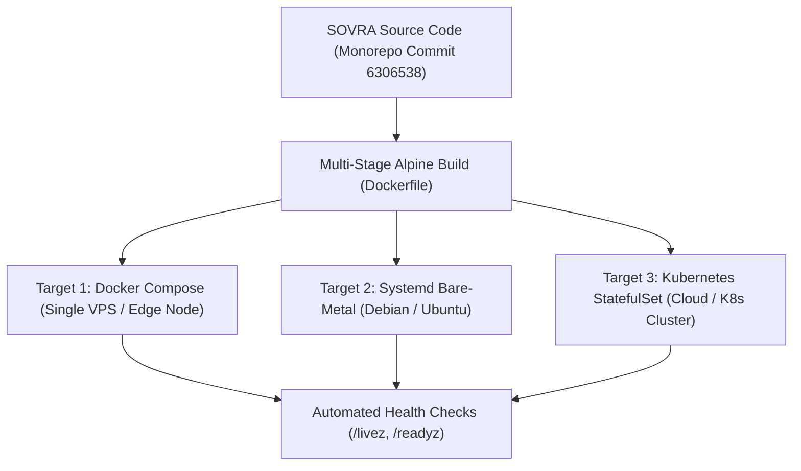
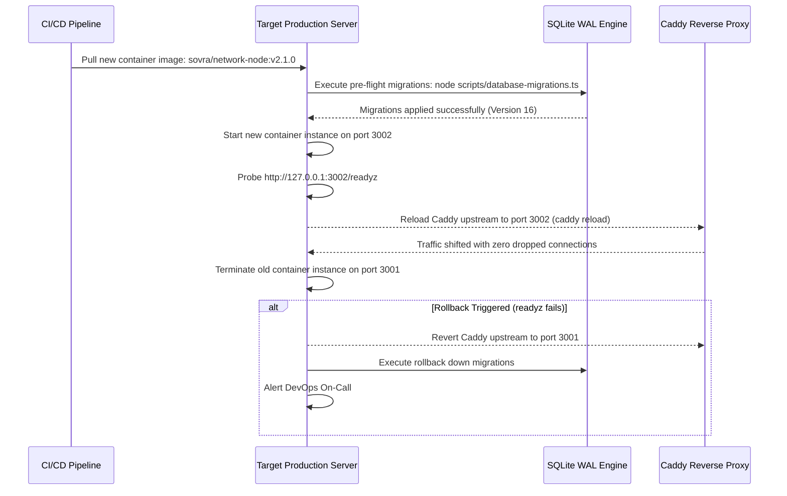

# SOVRA — PORTABLE DEPLOYMENT & OPERATIONS GUIDE

> **Standard:** Universal Multi-Environment Deployment Specification  
> **Status:** Phase 0 Architecture Deliverable  
> **Repository Commit:** `6306538` | **Date:** 2026-11-05  

---

## 1. Universal Portability Principles

SOVRA rejects proprietary cloud runtime lock-in (such as AWS Elastic Beanstalk, Google App Engine, or Azure Container Apps). Every SOVRA service is engineered to run on **any standard Linux kernel supporting OCI containers or Node.js/Go runtimes**.

---

## 2. Supported Deployment Substrates



---

## 3. Environment Variable Configuration Catalog

Configuration is governed by [`scripts/env-validator.ts`](file:///d:/Sovra/scripts/env-validator.ts). The following parameters define node behavior:

| Variable Name | Required? | Default (Dev) | Production Rule | Purpose & Impact |
|:---|:---:|:---:|:---|:---|
| `NODE_ENV` | Yes | `development` | Must be `production` | Enables security headers, disables debug stack traces. |
| `PORT` / `SOVRA_HTTP_PORT` | No | `3001` | Integer (1–65535) | Ingress port for REST API and WebSocket gateway. |
| `SOVRA_P2P_PORT` | No | `4001` | Integer (1–65535) | External TCP port for Noise_XX P2P mesh and BitSwap. |
| `SOVRA_STORAGE_DIR` | No | `./.sovra-storage-dev` | `/app/.sovra-storage-prod` | Mount path for SQLite database, media, and keys. |
| `ADMIN_SECRET_KEY` | **YES** | Fallback demo key | $\ge 32$ cryptographically random chars | Master administrative token; fail-closed check. |
| `SOVRA_THROTTLE_SECRET` | **YES** | Fallback demo key | $\ge 32$ chars (supports comma rotation) | HMAC secret for client rate-limiting and session cookies. |
| `SOVRA_ALLOWED_ORIGINS` | No | `http://localhost:3000` | Comma-separated trusted HTTPS domains | CORS origin whitelist (wildcard `*` strictly rejected in prod). |
| `SOVRA_TURN_SERVERS` | No | Google STUN fallback | Comma-separated STUN/TURN URLs | WebRTC NAT traversal ICE relay endpoints. |
| `SOVRA_TURN_SECRET` | No | Demo turn secret | $\ge 32$ chars matching Coturn config | HMAC-SHA1 secret for ephemeral WebRTC credentials. |
| `SOVRA_MEDIA_STORAGE_BACKEND` | No | `local` | `local` or `s3` | Selects CAS storage backend driver (`media-storage-adapter.ts`). |
| `SOVRA_S3_BUCKET` | If S3 | None | Valid bucket name (e.g. `sovra-prod-media`) | Target S3 / Cloudflare R2 bucket for media uploads. |

---

## 4. Deployment Substrate Runbooks

### 4.1 Substrate A: Turnkey Docker Compose (Recommended for VPS)
1. **Clone repository and setup environment:**
   ```bash
   git clone https://github.com/ewanbabu36-cell/sovra.git /opt/sovra
   cd /opt/sovra
   cp .env.example .env.production
   # Generate high-entropy production secrets
   sed -i "s/replace_with_a_cryptographically_secure_random_key_min_32_chars!/$(openssl rand -hex 32)/" .env.production
   sed -i "s/replace_with_turn_server_hmac_secret_min_32_chars!/$(openssl rand -hex 32)/" .env.production
   ```
2. **Launch multi-container production stack:**
   ```bash
   docker compose -f docker/docker-compose.production.yml --env-file .env.production up -d --build
   ```
3. **Verify stack health:**
   ```bash
   curl -f http://localhost:3001/livez
   curl -f http://localhost:3001/readyz
   docker compose -f docker/docker-compose.production.yml ps
   ```

### 4.2 Substrate B: Native Linux Systemd Service (Bare-Metal)
1. **Run automated installer:**
   ```bash
   sudo bash deploy/install.sh
   ```
2. **Configure and start Systemd unit:**
   ```bash
   sudo cp deploy/sovra-node.service /etc/systemd/system/
   sudo systemctl daemon-reload
   sudo systemctl enable --now sovra-node
   sudo systemctl status sovra-node
   ```

### 4.3 Substrate C: Kubernetes Cluster Deployment
1. **Apply Namespace, Secrets, and StatefulSet:**
   ```bash
   kubectl apply -f deploy/kubernetes/sovra-node.yaml
   kubectl apply -f deploy/kubernetes/sovra-coturn.yaml
   ```
2. **Verify pod startup & PVC mounting:**
   ```bash
   kubectl get pods -n sovra-system
   kubectl describe statefulset sovra-node -n sovra-system
   ```

---

## 5. Zero-Downtime Rollout & Rollback Procedures



---

## 6. Software Bill of Materials (SBOM) & Container Hardening

- **Base Image:** Minimal `node:22-alpine` ($< 180\text{ MB}$ compressed).
- **Non-Root Execution:** Enforced via `USER node` (UID 1000). Root capabilities dropped in Kubernetes (`drop: [ALL]`).
- **Read-Only Root Filesystem:** Temporary files mapped to `/tmp` in tmpfs.
- **Vulnerability Scanning:** Automated Trivy container scans in `.github/workflows/production-release.yml` blocking on Critical/High CVEs.
