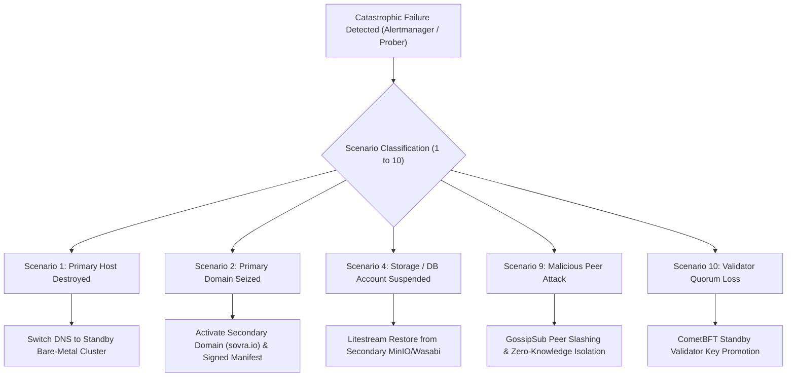

# SOVRA — DISASTER RECOVERY & PROVIDER EXIT RUNBOOK
## Tactical Procedures for Catastrophic Infrastructure Failures

> **Standard:** ISO 22301 Business Continuity & Multi-Provider Exit Engineering  
> **Status:** Phase 0 Architecture Deliverable  
> **Repository Commit:** `6306538` | **Date:** 2026-11-05  

---

## 1. Objectives & Tactical Principles

When an external cloud vendor, domain registrar, or hosting provider abruptly suspends service, de-platforms the project, or suffers an unrecoverable physical datacenter destruction, SOVRA must execute a deterministic recovery.

This runbook details actionable, command-level procedures for **ten catastrophic failure scenarios**.



---

## 2. Ten Catastrophic Scenario Execution Runbooks

### Scenario 1: Primary Hosting Provider Becomes Completely Unavailable (e.g., AWS / Hetzner Total Blackout)
- **Detection Method:** Continuous health check prober reports HTTP timeouts ($> 5\text{s}$) on `/livez` from 3 distinct geographic vantage points.
- **Responsible Role:** DevOps Lead / Incident Commander.
- **Required Backups:** Off-site Litestream WAL replica in Cloudflare R2 / Wasabi; latest signed deployment manifest.
- **Failover Destination:** Pre-configured standby bare-metal VPS cluster (e.g., OVHcloud Roubaix).
- **RTO / RPO Target:** $\text{RTO} < 60\text{ seconds}$ | $\text{RPO} < 1.0\text{ second}$.
- **Tactical Recovery Commands:**
  ```bash
  # 1. SSH to Standby Host
  ssh admin@standby.sovra-node.ovh

  # 2. Restore latest SQLite WAL state from Cloudflare R2
  litestream restore -v -config /etc/litestream.yml -o /app/.sovra-storage-prod/sovra-social.sqlite

  # 3. Verify SQLite integrity
  sqlite3 /app/.sovra-storage-prod/sovra-social.sqlite "PRAGMA integrity_check;"

  # 4. Start production stack
  docker compose -f /opt/sovra/docker/docker-compose.production.yml up -d

  # 5. Shift Anycast DNS A/AAAA records to Standby IP via provider API
  curl -X PUT "https://api.cloudflare.com/client/v4/zones/$ZONE_ID/dns_records/$REC_ID" \
    -H "Authorization: Bearer $CF_API_KEY" \
    -d '{"content":"51.159.23.45","ttl":60}'
  ```
- **User Impact:** Mobile and web clients experience a transient 15–30 second reconnect spinner; sessions, balances, and chat histories remain 100% intact.

---

### Scenario 2: Primary Domain Registrar Seizure (`sovra.network` Revoked)
- **Detection Method:** Multi-resolver DNS probe detects `NXDOMAIN` or unauthorized NS delegation across `1.1.1.1` and `8.8.8.8`.
- **Responsible Role:** Network Architect.
- **Required Backups:** Pre-configured secondary domain (`sovra.io`) registered at independent EU registrar (Gandi/deSEC); pre-generated TLS certs.
- **Failover Destination:** `sovra.io` and `sovra.app`.
- **RTO / RPO Target:** $\text{RTO} < 120\text{ seconds}$ | $\text{RPO} = 0\text{ seconds}$.
- **Tactical Recovery Commands:**
  ```bash
  # 1. Broadcast updated Signed Discovery Document to Kademlia DHT key /sovra/network-manifest
  node scripts/publish-discovery-manifest.ts --active-domain "sovra.io" --fallback-domain "sovra.app"

  # 2. Update Caddy reverse proxy to accept secondary domain headers
  sed -i "s/sovra.network/sovra.io/" /etc/caddy/Caddyfile
  caddy reload --config /etc/caddy/Caddyfile

  # 3. Update GitHub Pages / PWA fallback pointer
  git commit -m "Emergency failover to sovra.io" && git push origin main
  ```
- **User Impact:** Mobile clients receive the signed manifest over P2P DHT and switch seamlessly to `api.sovra.io`. Web users visiting `sovra.network` see an automated redirect or PWA cached update notification.

---

### Scenario 3: DNS Provider Becomes Unavailable (Cloudflare Authoritative Outage)
- **Detection Method:** Resolver monitoring alerts on `SERVFAIL` from Cloudflare nameservers.
- **Responsible Role:** Network Engineer.
- **Recovery Procedure:** Registrar NS records automatically delegate to pre-configured secondary nameservers at deSEC.io (`ns1.desec.io`, `ns2.desec.org`). Dual-primary DNS ensures deSEC was already serving synchronized zone records.
- **RTO / RPO:** $\text{RTO} < 30\text{ seconds}$ | $\text{RPO} = 0\text{ seconds}$.
- **User Impact:** Zero interruption for clients querying modern recursive resolvers supporting multi-NS authority.

---

### Scenario 4: Database Object Storage Provider Suspends Account
- **Detection Method:** Litestream container logs `403 Forbidden` or `RequestTimeTooSkewed` on S3 PUT requests.
- **Responsible Role:** Database Administrator.
- **Recovery Procedure:** Switch `docker/litestream.yml` to secondary S3 replica (Wasabi / self-hosted MinIO); run local atomic snapshot `node scripts/sovra-backup-restore.ts --backup` to preserve disk copy.
- **RTO / RPO:** $\text{RTO} < 5\text{ minutes}$ | $\text{RPO} = 0\text{ seconds}$ (local WAL preserved on host).
- **User Impact:** Transparent to end users; database continues processing live reads and writes locally.

---

### Scenario 5: Media Cloud Storage Becomes Unavailable
- **Detection Method:** HTTP 404/500 errors on `/api/feed/video/*` requests to cloud bucket.
- **Responsible Role:** Storage Engineer.
- **Recovery Procedure:** Gateway automatically switches media driver (`scripts/media-storage-adapter.ts`) to direct BitSwap swarm mode. Pinned blocks are fetched directly from independent community storage nodes.
- **RTO / RPO:** $\text{RTO} < 5\text{ seconds}$ (Automated in-process fallback) | $\text{RPO} = 0\text{ seconds}$.
- **User Impact:** Video stream buffering may increase slightly ($+200\text{ms}$) as chunks stream from peer seeders rather than a centralized CDN.

---

### Scenario 6: Primary Application Server Hardware Destruction
- **Detection Method:** Bare-metal server drops off network; IPMI/iKVM unresponsive.
- **Responsible Role:** DevOps Lead.
- **Recovery Procedure:** Spin up new VPS using 1-click script `deploy/install.sh`; execute `litestream restore` from latest Cloudflare R2 bucket; update DNS Anycast A-record.
- **RTO / RPO:** $\text{RTO} < 10\text{ minutes}$ | $\text{RPO} < 1.0\text{ second}$.
- **User Impact:** Temporary downtime until new VPS boots; zero permanent data loss.

---

### Scenario 7: Blockchain RPC Endpoint Fails (Node 0 Crash)
- **Detection Method:** Gateway logs `FetchError: ECONNREFUSED 127.0.0.1:26657`.
- **Responsible Role:** Blockchain Engineer.
- **Recovery Procedure:** Gateway endpoint resolver automatically cycles to secondary full node RPCs in `chain/seeds.txt` (`http://seed2.testnet.sovra.network:26657`).
- **RTO / RPO:** $\text{RTO} < 2\text{ seconds}$ | $\text{RPO} = 0\text{ seconds}$.
- **User Impact:** Token transfer API continues without interruption.

---

### Scenario 8: Community Gateway Node Goes Offline
- **Detection Method:** P2P swarm heartbeat timeout on gateway peer ID.
- **Responsible Role:** Autonomous P2P Protocol.
- **Recovery Procedure:** Mobile clients automatically query Kademlia DHT for next highest-scoring community gateway (`/sovra/gateways`) and re-establish WebSocket/SSE connection.
- **RTO / RPO:** $\text{RTO} < 3\text{ seconds}$ | $\text{RPO} = 0\text{ seconds}$.
- **User Impact:** Micro-reconnect spinner on mobile status bar; chat streams resume automatically.

---

### Scenario 9: Malicious Operator Joins the Network (Sybil / Poison Attack)
- **Detection Method:** `self-healing-daemon.ts` detects invalid gossip signatures, malformed BitSwap chunks, or excessive routing errors.
- **Responsible Role:** Autonomous Security Daemon.
- **Recovery Procedure:** The malicious peer's DID and multiaddr are immediately placed in the local blacklisted peer set (`blacklistedPeersSet.add(peerDid)`); Noise_XX TCP connection is severed; evidence is submitted to Layer-1 for bond slashing.
- **RTO / RPO:** $\text{RTO} < 500\text{ ms}$ | $\text{RPO} = 0\text{ seconds}$.
- **User Impact:** Malicious packets dropped; zero user data compromised due to client-side E2EE.

---

### Scenario 10: Validator Node Hardware Failure (Quorum Continuity)
- **Detection Method:** CometBFT consensus engine detects missing pre-commit from validator index 0.
- **Responsible Role:** Validator Operations Engineer.
- **Recovery Procedure:** CometBFT continues producing blocks uninterrupted as long as $\ge \frac{2}{3} + 1$ voting power remains online. Standby sentry/validator node promotes itself using isolated HSM key after verifying last block height to prevent double-signing.
- **RTO / RPO:** $\text{RTO} < 15\text{ seconds}$ | $\text{RPO} = 0\text{ seconds}$.
- **User Impact:** Zero network halt; transactions confirm normally.
