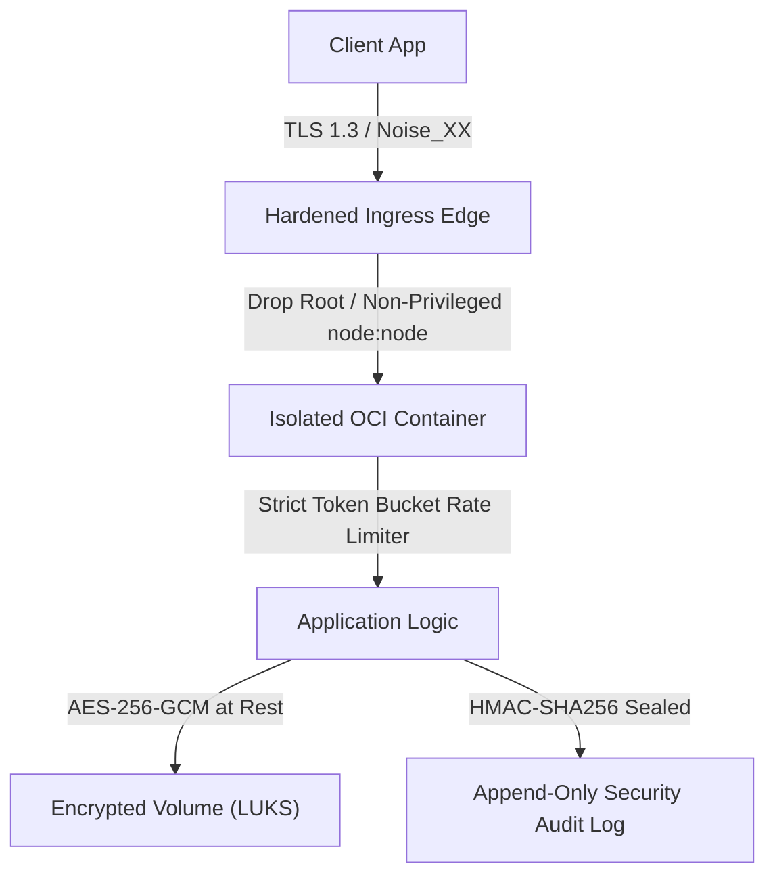
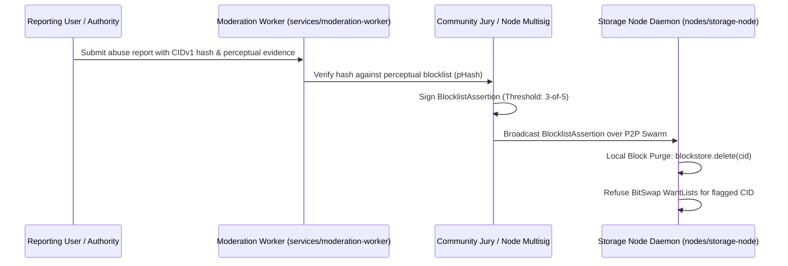

# SOVRA — INFRASTRUCTURE SECURITY, PRIVACY & LEGAL COMPLIANCE SPECIFICATION

> **Standard:** Zero-Trust Enterprise Security & Global Privacy Regulatory Compliance  
> **Status:** Phase 0 Architecture Deliverable  
> **Repository Commit:** `6306538` | **Date:** 2026-11-05  

---

## 1. Security Philosophy & Legal Reality

Decentralization does not exempt a technology ecosystem from statutory legal responsibilities, privacy regulations, consumer protection standards, or criminal law.

SOVRA balances **uncompromising cryptographic privacy** (zero-knowledge E2EE, Passkey authentication, self-sovereign DIDs) with **rigorous regulatory compliance** across key jurisdictions:
- **India:** Digital Personal Data Protection Act (DPDP Act 2023) & Information Technology Act 2000.
- **European Union:** General Data Protection Regulation (GDPR, Regulation EU 2016/679) & Digital Services Act (DSA).
- **United States:** Children's Online Privacy Protection Act (COPPA) & Electronic Communications Privacy Act (ECPA).

---

## 2. Infrastructure Security Baseline



### 2.1 Least-Privilege & Container Hardening
- **User Isolation:** All containers run strictly under unprivileged service users (`node:node` UID/GID 1000) in both [`Dockerfile`](file:///d:/Sovra/Dockerfile) and [`docker/Dockerfile.production`](file:///d:/Sovra/docker/Dockerfile.production).
- **Kernel Capability Dropping:** In Kubernetes manifests ([`deploy/kubernetes/sovra-node.yaml`](file:///d:/Sovra/deploy/kubernetes/sovra-node.yaml)), all Linux capabilities are dropped:
  ```yaml
  securityContext:
    allowPrivilegeEscalation: false
    capabilities:
      drop:
        - ALL
  ```
- **Read-Only Root Filesystem:** Production containers execute with read-only root filesystems; writable directories are strictly restricted to persistent volume mounts (`/app/.sovra-storage-prod`) and memory-backed tmpfs (`/tmp`).

### 2.2 Cryptographic Secret Management & Log Scrubbing
Governed by [`scripts/env-validator.ts`](file:///d:/Sovra/scripts/env-validator.ts):
- **Fail-Closed Execution:** In production mode (`NODE_ENV=production`), the application terminates immediately if `ADMIN_SECRET_KEY` or `SOVRA_THROTTLE_SECRET` is unset, shorter than 32 characters, or matches known default/demo dictionary keys.
- **Automatic Log Redaction:** All diagnostic logging formatters scrub tokens, session IDs, authorization headers, and private key representations before outputting to stdout or JSON logs.

### 2.3 Network Segmentation & DDoS Mitigation
1. **Edge Token Bucket Rate Limiting:** Ingress limits requests to a maximum burst capacity of 200 requests with a refill rate of 40 requests/second per IP address (`SOVRA_RATE_LIMIT_CAPACITY=200`, `SOVRA_RATE_LIMIT_REFILL=40`).
2. **P2P GossipSub Throttling:** Libp2p streams reject messages $> 64\text{ KB}$ and disconnect peers exceeding 50 messages/second.
3. **Internal Subnet Shielding:** Validator consensus ports (26656) and database IPC sockets are isolated from public ingress.

---

## 3. Data Protection & Privacy Regulatory Framework

### 3.1 DPDP Act 2023 (India) Compliance
- **Data Fiduciary vs Processor:** Independent node operators process only encrypted, pseudonymized ciphertext blobs; they hold no cryptographic keys to decrypt user messages or private feeds.
- **Notice & Consent:** Users provide verifiable, explicit digital consent during onboarding; all consent receipts are anchored cryptographically to the user's DID.
- **Right to Grievance Redressal:** Transparent on-chain reporting mechanism allowing users to submit dispute tickets to elected community jury delegates.
- **Children's Privacy Protection:** Mandatory parental consent gates and absence of targeted behavioral profiling for minors.

### 3.2 GDPR (European Union) Compliance
- **Data Minimization (Article 5):** No tracking pixels, device fingerprinting, or invasive analytics. IP addresses logged in operational traces are masked to `/24` IPv4 subnets (`maskIpAddress()` in `scripts/database-sqlite.ts`).
- **Right to Erasure / Right to Be Forgotten (Article 17):** Verified via `scripts/database-sqlite.ts` tombstoning and `PRAGMA incremental_vacuum` ensuring permanent byte-level reclamation from disk blocks.
- **Data Portability (Article 20):** Users can export their complete profile, social graph, and content history in standard JSON and UnixFS DAG formats at any time.

---

## 4. Takedown Governance & Illegal Content Response

Decentralization must never harbor child sexual abuse material (CSAM), non-consensual imagery, or violent extremism.


- Content that is flagged and confirmed by legal order or multisig threshold is purged from all cooperating storage nodes.
- Zero private user messages are read or altered during the process; takedowns operate strictly on public media CIDs.
