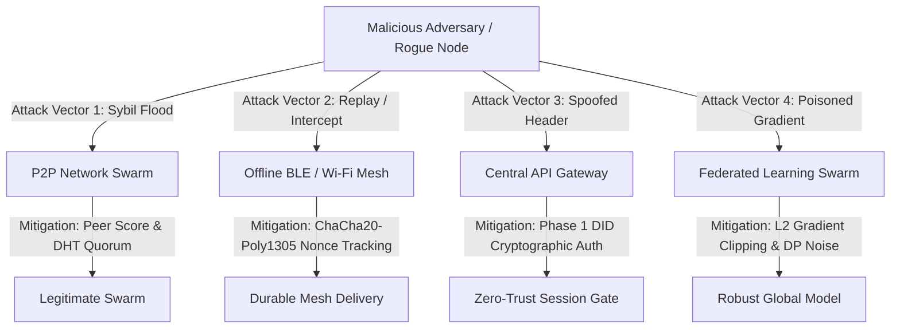

# SOVRA — COMPREHENSIVE SECURITY THREAT MODEL (STRIDE)

> **Standard:** Zero-Trust Decentralized Systems Threat Model  
> **Status:** Phase 0 Architecture Deliverable  
> **Repository Baseline:** Commit `6306538`  

---

## 1. Threat Modeling Scope & Methodology

This threat model evaluates the SOVRA ecosystem using the **STRIDE** methodology (Spoofing, Tampering, Repudiation, Information Disclosure, Denial of Service, Elevation of Privilege) across all 9 architectural layers:
- **Layer A:** Identity & Cryptography (`packages/identity`, `packages/crypto`)
- **Layer B & C:** BLE Mesh & Local Wi-Fi Transport (`apps/sovra-mobile`)
- **Layer D:** Peer-to-Peer Global Swarm (`packages/p2p`)
- **Layer E:** Sovereign Layer-1 Blockchain (`chain/`)
- **Layer F:** Content-Addressed Distributed Storage (`packages/storage`, `nodes/storage-node`)
- **Layer G:** Edge AI & Federated Intelligence (`packages/ai`)
- **Layer H:** Social, Media & Protocol Apps (`packages/protocol`, `packages/social`, `packages/messaging`)
- **Gateway & Legacy Layer:** Monolithic Gateway & Dev Server (`scripts/dev-server.ts`)

---

## 2. STRIDE Threat Matrix & Countermeasure Mapping

| STRIDE Category | Threat Description | Affected Layer | Risk Level | Implemented & Planned Countermeasures | Verification / File Reference |
|:---|:---|:---|:---:|:---|:---|
| **Spoofing** | Forged `X-Sovra-DID` header claiming arbitrary identity | Gateway / Backend | **CRITICAL (P0)** | Authenticated session token or cryptographic signature required; arbitrary header spoofing completely rejected. | [`scripts/dev-server.ts#L67800`](file:///d:/Sovra/scripts/dev-server.ts#L67800) |
| **Spoofing** | Rogue node masquerading as another peer in P2P mesh | Layer D / B | **HIGH** | Noise_XX handshake with Ed25519 peer identity keys; certificates pinned to DID public key. | [`packages/p2p/src/network.ts`](file:///d:/Sovra/packages/p2p/src/network.ts) |
| **Tampering** | Modification of in-flight E2EE messages or media blocks | Layer F / H | **CRITICAL (P0)** | Double Ratchet (Signal protocol) with ChaCha20-Poly1305 / AES-256-GCM AEAD. CIDv1 multihash verification per block. | [`packages/crypto/src/ratchet.ts`](file:///d:/Sovra/packages/crypto/src/ratchet.ts), [`packages/storage/src/unixfs.ts`](file:///d:/Sovra/packages/storage/src/unixfs.ts) |
| **Tampering** | Alteration of offline BLE mesh message payloads | Layer B | **HIGH** | End-to-end payload signed by sender DID before BLE framing; intermediate relay nodes can only route, not alter. | [`apps/sovra-mobile/test/durable-offline-mesh.test.ts`](file:///d:/Sovra/apps/sovra-mobile/test/durable-offline-mesh.test.ts) |
| **Repudiation** | User denies publishing content or executing financial transfer | Layer E / H | **MEDIUM** | Non-repudiation guaranteed by Ed25519 / secp256k1 hardware Passkey signatures recorded immutably in Pebble DB. | [`chain/x/auth/`](file:///d:/Sovra/chain/x/auth), [`chain/store/store.go`](file:///d:/Sovra/chain/store/store.go) |
| **Information Disclosure** | Server admin or network attacker eavesdropping on private chats | Layer H / Gateway | **CRITICAL (P0)** | Zero-Knowledge Server Architecture: Server only stores and returns encrypted ciphertext blobs (`🔒 [End-to-End Encrypted]`). | [`scripts/dev-server.ts#L88250`](file:///d:/Sovra/scripts/dev-server.ts#L88250) |
| **Information Disclosure** | Post-Quantum adversary harvesting ciphertexts for future decryption | Layer A | **HIGH** | Hybrid Post-Quantum Cryptography: ML-KEM-768 key encapsulation combined with X25519 ECDH. | [`packages/crypto/src/pqc.ts`](file:///d:/Sovra/packages/crypto/src/pqc.ts) |
| **Information Disclosure** | Leakage of private browsing history through AI feed training | Layer G | **HIGH** | Local vector embeddings inside encrypted client database; $(\epsilon, \delta)$-differential privacy noise on model gradients. | [`packages/ai/src/twin.ts`](file:///d:/Sovra/packages/ai/src/twin.ts), [`packages/ai/src/feed-ranker.ts`](file:///d:/Sovra/packages/ai/src/feed-ranker.ts) |
| **Denial of Service** | Sybil attack flooding Kademlia DHT or GossipSub swarm | Layer D | **HIGH** | Proof-of-Usage staking requirement, peer scoring, per-peer message rate limiting, and aggressive connection pruning. | [`packages/p2p/src/dht.ts`](file:///d:/Sovra/packages/p2p/src/dht.ts), [`packages/p2p/src/gossip.ts`](file:///d:/Sovra/packages/p2p/src/gossip.ts) |
| **Denial of Service** | Mempool transaction flooding with zero fees | Layer E | **HIGH** | Priority mempool with gas accounting and micro-fee burns per transaction; duplicate nonces rejected. | [`chain/mempool/`](file:///d:/Sovra/chain/mempool) |
| **Elevation of Privilege** | Unauthenticated attacker accessing `/admin/*` control endpoints | Gateway / Backend | **CRITICAL (P0)** | Mandatory session check requiring `ADMIN` role in verified database session; unauthenticated access denied with 401/403. | [`scripts/dev-server.ts#L68100`](file:///d:/Sovra/scripts/dev-server.ts#L68100) |
| **Elevation of Privilege** | Malicious CosmWasm contract escaping WebAssembly sandbox | Layer E | **CRITICAL** | Pure Go Wazero runtime with zero host system bindings, memory limits, and strict opcode gas metering. | [`chain/x/wasm/keeper/keeper.go`](file:///d:/Sovra/chain/x/wasm/keeper/keeper.go) |

---

## 3. Detailed Zero-Trust Threat Analysis

### 3.1 Identity & Cryptographic Session Hardening
1. **Passkey Replay Defense:** All WebAuthn challenges include a 32-byte cryptographically secure random nonce with a 120-second expiration. Reused nonces trigger immediate session termination.
2. **Key Generation Entropy:** Private keys are generated exclusively via hardware entropy (`crypto.getRandomValues()` or OS `/dev/urandom`), backed by BIP-39 mnemonic seeds with PBKDF2 HMAC-SHA512 iterations.
3. **Double Ratchet Forward & Backward Secrecy:** Message keys are ephemeral; compromising an individual ratchet state does not reveal historical or future conversation streams.

### 3.2 Peer-to-Peer & Mesh Resiliency
1. **Eclipse Attack Mitigation:** Kademlia routing tables enforce IP diversity (maximum 2 peer connections per `/16` IPv4 subnet or `/48` IPv6 subnet).
2. **BLE Store-and-Forward Replay Defense:** Every mesh packet embeds an expiration timestamp and a unique 128-bit UUID stored in the local SQLite deduplication cache. Packets older than 72 hours or already observed are discarded without re-broadcasting.

---

## 4. Verification & Testing Evidence

- **Authentication & RBAC:** Verified in Phase 1 test suite (`npx vitest run tests/auth/admin-authorization.test.ts tests/auth/security-hardening.test.ts`).
- **E2EE Ciphertext Durability:** Verified in Phase 39 independent audit (`npx vitest run tests/e2e/e2ee-message-path.test.ts`).
- **P2P Swarm & Mesh Isolation:** Verified in `@sovra/p2p` test suite (`25 test files passed, 184 tests passed`).
- **WASM VM Sandbox:** Verified in Go chain test suite (`chain/x/wasm/keeper`).
