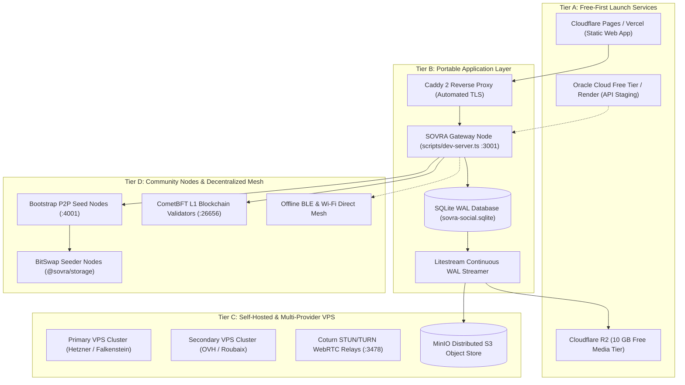

# SOVRA — SELF-SUSTAINING INFRASTRUCTURE BLUEPRINT
## Master Architecture for Provider-Independent, Community-Operated Systems

> **Standard:** Sovereign High-Availability Systems Blueprint  
> **Status:** Phase 0 Architecture Deliverable  
> **Repository Commit:** `6306538` | **Date:** 2026-11-05  

---

## 1. Vision & Core Infrastructure Principles

SOVRA is engineered as an anti-fragile, self-sustaining digital ecosystem combining social networking, multimedia broadcasting, encrypted communication, and economic settlement.

To prevent de-platforming, single-point failures, or infrastructure hostage-taking, SOVRA operates on **twelve non-negotiable infrastructure principles**:
1. **No Single Hosting Provider:** The network survives the complete termination of any cloud account or data center.
2. **No Single Domain Registrar:** Resolution does not collapse if an individual registrar revokes or freezes a domain.
3. **No Single Administrator Kill Switch:** No individual root credential or admin token can permanently destroy network state or halt the consensus chain.
4. **Absolute Data Portability:** All application schemas and storage layouts export cleanly to standard open formats (SQLite, JSON, UnixFS DAGs).
5. **Continuous Independent Backups:** Database states are replicated continuously to multi-jurisdiction storage with sub-second RPO.
6. **Open Media Storage Federation:** Content storage is federated across independent node operators via BitSwap.
7. **Sovereign Blockchain Consensus:** Consensus is operated by independent community validators; the monetary ledger is completely decoupled from the web application database.
8. **Reproducible Deployability:** Any node can be provisioned deterministically from scratch using version-controlled Infrastructure-as-Code and container manifests.
9. **Seamless Live Migration:** Any service subsystem can migrate to an alternate host without requiring client app updates or downtime.
10. **Cryptographic Identity Sovereignty:** User accounts are W3C DIDs governed by client-held private keys; no server holds or can impersonate user credentials.
11. **Ledger Immutability:** Application gateway failure or database corruption never invalidates or alters the CometBFT Layer-1 monetary ledger.
12. **Pragmatic Free-First Philosophy:** Free-tier services are leveraged strategically for bootstrap cost reduction, but are **never treated as permanent or guaranteed infrastructure**.

---

## 2. Four-Tier Infrastructure Topology

---

## 3. Layered Data Sovereignty & Classification

To ensure regulatory compliance and privacy preservation across decentralized nodes, data is partitioned into six distinct isolation categories:

| Data Class | Contents | Storage Substrate | Encryption Standard | Community Node Replication Policy |
|:---|:---|:---|:---|:---|
| **Class A: Application State** | Public profiles, post metadata, public comments, channel info | SQLite (`sovra-social.sqlite`) | Encrypted at rest (LUKS / AES-256) | Replicated across verified gateway nodes. |
| **Class B: Private User Data** | Direct messages, private media attachments, contact lists | SQLite + Client Key Vault | **Zero-Knowledge E2EE** (Double Ratchet + AES-256-GCM) | Server and community nodes hold only unreadable ciphertext blobs (`🔒 [End-to-End Encrypted]`). |
| **Class C: Public Content** | Videos, photos, reels, podcast audio chunks | BitSwap Merkle DAGs (`nodes/storage-node`) | Unencrypted; CIDv1 SHA2-256 Multihash verified | Replicated freely across all incentivized storage seeders. |
| **Class D: Financial & Token State** | Account balances, coin emissions, escrows, contract state | CometBFT Pebble DB (`chain/store`) | Deterministic Merkle State Triangulation | Replicated exclusively across authorized blockchain validators. |
| **Class E: Operational Telemetry** | Health metrics, peer RTT, error rates, CPU/RAM usage | Prometheus + Memory Buffers | Plaintext metrics | Publicly scraped via `/metrics` on port 8080 and 3001. |
| **Class F: Security Audit Logs** | Administrative actions, session rotations, IP access records | SQLite `audit_logs` + Append-only files | HMAC-SHA256 tamper-sealed | Private to instance operator; retained for 90 days. |

---

## 4. Multi-Provider Ingress & Service Discovery

Clients discover active endpoints through an immutable, multi-layered failover sequence:
1. **Primary Domain:** Query `api.sovra.network` via anycast DNS.
2. **Backup Mirror:** If primary fails to resolve within 3.0s, switch to `api.sovra.io` or `api.sovra.app`.
3. **Signed Discovery Manifest:** Fetch `https://raw.githubusercontent.com/.../network-manifest.json` or decentralized storage CID `bafybeic...`. Manifest contains Ed25519 signature from SOVRA Governance DID.
4. **P2P Rendezvous:** Fall back to Kademlia DHT key `/sovra/gateways` on port 4001 to discover community gateway peers.

---

## 5. Free-First Launch to Community Self-Sustenance Roadmap

- **Stage 1 (Free-First Launch, Month 0–3):** Deploy static frontend to Cloudflare Pages; run API gateway on Oracle Cloud Free Tier or low-cost VPS (\$4/mo); use Cloudflare R2 free tier (10 GB) for initial media.
- **Stage 2 (Multi-Provider Hardening, Month 3–6):** Spin up secondary VPS on alternate provider (e.g. Hetzner); activate Litestream dual-replication to MinIO and Wasabi; deploy 3 independent CometBFT seed nodes.
- **Stage 3 (Community Federation, Month 6–12):** Onboard independent community node operators; activate Proof-of-Usage storage incentives; transition video streaming to community BitSwap seeders.
- **Stage 4 (Full Decentralization, Month 12+):** Gateway role transitions from central host to decentralized community cluster; monetary treasury funded by transparent 5% burn / creator fees; 100% provider-independent operations.
