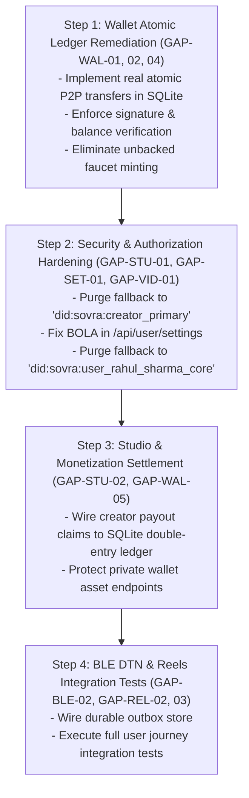

# SOVRA — SIX CORE MODULES GAP ANALYSIS
## Forensic Gap Mapping, Threat Modeling & Remediation Strategy

**Document ID:** SOVRA-GAP-6MOD-001  
**Task ID:** SOVRA-SIX-MODULE-REBUILD-001  
**Repository Working Directory:** `d:\Sovra`  
**Baseline Git Commit:** `63065389167c1968163d0fde929d46443bf3fcaa`  
**Date of Audit:** November 2026  

---

## 1. Executive Summary

This Gap Analysis provides the structured prerequisite blueprint before modifying any production application source code. It itemizes the architectural defects, security vulnerabilities, missing execution paths, and invariant violations discovered during the Initial Forensic Audit across the six core modules:
1. **Wallet**
2. **Creator Studio**
3. **BLE / SOVRA Mesh**
4. **Settings**
5. **Video**
6. **Reels**

---

## 2. Module 1: Wallet Gap Analysis

| Gap ID | Original Vision | Existing Implementation | Evidence (File & Line) | Class (A–H) | Missing Functionality | Risk | Priority | Dependencies | Remediation Strategy | Acceptance Criteria | Required Tests |
| :--- | :--- | :--- | :--- | :--- | :--- | :--- | :--- | :--- | :--- | :--- | :--- |
| **GAP-WAL-01** | Authentic P2P token transfer with cryptographic signature verification and double-entry ledger mutation | Returns instantaneous dummy random hex hash without deducting sender or crediting recipient | `scripts/routes/wallet.routes.ts:495-528` | **D (Mock) / F (Vuln) / G (Invariant)** | Balance deduction, recipient crediting, Ed25519 signature check, double-entry in `token_transfers` | Zero funds actually move; users can fake payments | **P0** | `packages/crypto`, `token_transfers` table | Implement atomic SQLite transaction: verify signature, check sufficient balance, deduct sender, credit recipient, record `token_transfers` entry | P2P transfer mutates SQLite balances atomically; fails if balance insufficient or signature invalid | `tests/security/wallet_atomic_transfers.test.ts` |
| **GAP-WAL-02** | 100M Lifetime Cap; zero unbacked synthetic currency minting | Faucet mints unbacked float SOV with random hex hash into SQLite `users.balance_sov` | `scripts/routes/wallet.routes.ts:411-460` `scripts/database-engine.ts:7840-7860` | **G (Constitutional & Economic Violation)** | Verification of backed genesis allocation pool; strict daily rate limits | Inflationary runaway; violates Constitutional Invariant 1 | **P0** | Database engine | Replace arbitrary minting with a strictly bounded testnet starter grant (max 50 SOV) allocated from a pre-defined genesis pool; enforce 24h per-DID rate limit | Faucet cannot exceed 50 SOV per 24h; total faucet disbursements tracked and bounded | Faucet rate-limit & supply cap test |
| **GAP-WAL-03** | Integer micro-SOV precision ($1\text{ SOV} = 10^6\;\mu\text{SOV}$) without floating-point arithmetic | SQLite and dev-server use JavaScript `REAL` floating-point numbers (`balance_sov`) | `scripts/database-sqlite.ts:291` `scripts/database-engine.ts:7840` | **G (Economic Invariant Violation)** | Micro-unit integer precision (`balance_usov`) matching Go consensus engine | IEEE-754 precision leakage; rounding exploits | **P1** | Database schema | Add integer micro-unit helper functions; ensure all financial math uses integer addition/subtraction | All balance mutations execute down to 1 uSOV integer precision without float rounding | Integer micro-SOV math unit test |
| **GAP-WAL-04** | Protection against double spending & transaction replay | No idempotency key validation on `/api/wallet/transfer` | `scripts/routes/wallet.routes.ts:495-515` | **F (Security Vulnerability)** | Anti-replay cache and idempotency key check in SQLite | Attacker replays signed transfer to drain user wallet | **P0** | `financial_idempotency_keys` table | Require unique idempotency key or nonce; store in `financial_idempotency_keys`; reject duplicates | Duplicate transaction submission with same nonce/idempotency key is rejected with HTTP 409 | Replay attack & race condition test |
| **GAP-WAL-05** | Unauthorized access prevention | `resolveUserAddress` accepts `?address=` or `?did=` from unauthenticated callers | `scripts/routes/wallet.routes.ts:28-42` | **F (BOLA/IDOR)** | Strict session authentication on private wallet asset queries | Any caller can inspect and query arbitrary user balances | **P1** | `enforceAuth` | Enforce authentication on `/api/wallet/assets`; verify caller address matches authenticated DID | Querying another user's private asset drawer without permission returns 403 Forbidden | BOLA wallet authorization test |

---

## 3. Module 2: Creator Studio Gap Analysis

| Gap ID | Original Vision | Existing Implementation | Evidence (File & Line) | Class (A–H) | Missing Functionality | Risk | Priority | Dependencies | Remediation Strategy | Acceptance Criteria | Required Tests |
| :--- | :--- | :--- | :--- | :--- | :--- | :--- | :--- | :--- | :--- | :--- | :--- |
| **GAP-STU-01** | Least-privilege creator authorization on all mutating studio operations | `resolveCreatorDid` falls back to `'did:sovra:creator_primary'` or trusts `?creatorDid=` | `scripts/routes/studio.routes.ts:31-41` | **F (BOLA/IDOR & Auth Bypass)** | `enforceAuth` wrapping on mutating endpoints (`/content/update`, `/delete`, `/payout`) | Unauthenticated callers modify or delete creator content | **P0** | Auth middleware | Replace `resolveCreatorDid` fallback with strict `enforceAuth(req, res)`; ensure caller owns target channel/video | Any unauthenticated mutation fails with HTTP 401; unauthorized creator mutation fails with HTTP 403 | Studio authorization & BOLA test |
| **GAP-STU-02** | Atomic creator payout claim with double-entry ledger settlement | Payout claim deducts pending balance in memory without writing to `token_transfers` | `scripts/routes/studio.routes.ts:1638-1660` | **C (Partial Implementation)** | Atomic transfer into creator's available wallet balance and `token_transfers` audit record | Inconsistent earnings; creator claims payout but wallet balance does not update | **P1** | Wallet ledger | Wire `/api/studio/monetization/claim-payout` to SQLite transaction: deduct pending earnings, credit creator `balance_sov`, record transfer voucher | Payout claim immediately reflects in creator's wallet balance and transaction history | Creator payout end-to-end test |
| **GAP-STU-03** | Real analytics based on underlying watch and view events | Aggregates view events from `watch_history` and `posts` tables | `scripts/routes/studio.routes.ts:787-844` | **A (Implemented)** | None; retention and second-by-second analytics operate correctly | Low | **P2** | SQLite analytics engine | Preserve existing analytics calculation logic | Analytics reflect genuine view events | Existing studio analytics tests |
| **GAP-STU-04** | Channel creation, customization and playlist management | Channel hub, customization save, and playlist CRUD exist | `scripts/routes/studio.routes.ts:964-1050` `scripts/routes/studio.routes.ts:1738-1770` | **B (Needs Test Hardening)** | Automated integration test verifying full channel lifecycle from create to delete | Channel state loss on server reload | **P1** | SQLite channels table | Add comprehensive integration test verifying channel creation, branding update, and playlist linkage | Channel updates persist durably across server restarts | Channel lifecycle test |

---

## 4. Module 3: BLE / SOVRA Mesh Gap Analysis

| Gap ID | Original Vision | Existing Implementation | Evidence (File & Line) | Class (A–H) | Missing Functionality | Risk | Priority | Dependencies | Remediation Strategy | Acceptance Criteria | Required Tests |
| :--- | :--- | :--- | :--- | :--- | :--- | :--- | :--- | :--- | :--- | :--- | :--- |
| **GAP-BLE-01** | Physical dual-device BLE mesh verification | Native Kotlin and Obj-C++ modules exist; tested via desktop simulation | `apps/sovra-mobile/android/.../SovraBleModule.kt` `scripts/ble-mesh-engine.ts` | **UNVERIFIED (Hardware)** | Physical hardware testbed execution with two mobile handsets | Unverified real-world RF attenuation and OS background execution | **P1** | Physical BLE hardware | Formally document physical status as UNVERIFIED; verify software protocol, DTN queues, and simulation harness | Software protocol engine verified; physical hardware status transparently classified | Software DTN test suite |
| **GAP-BLE-02** | Delay-Tolerant Networking (DTN) packet deduplication and anti-looping | In-memory packet queue tracks visited peers and TTL hops | `scripts/ble-mesh-engine.ts:180-240` `packages/p2p/src/mesh/mesh-router.ts` | **A (Verified in Engine)** | Durable SQLite persistence for outbox queue across app restarts | In-flight mesh packets lost if device battery dies | **P1** | Local SQLite database | Wire DTN outbox store to local SQLite in `apps/sovra-mobile/src/services/local-database.ts` | Queued mesh packets survive process termination | Durable outbox test |

---

## 5. Module 4: Settings Gap Analysis

| Gap ID | Original Vision | Existing Implementation | Evidence (File & Line) | Class (A–H) | Missing Functionality | Risk | Priority | Dependencies | Remediation Strategy | Acceptance Criteria | Required Tests |
| :--- | :--- | :--- | :--- | :--- | :--- | :--- | :--- | :--- | :--- | :--- | :--- |
| **GAP-SET-01** | Secure user settings mutation with strict self-authorization | POST `/api/user/settings` accepts `?did=` query parameter without checking caller identity | `scripts/dev-server.ts:91149-91165` | **F (BOLA/IDOR Vulnerability)** | Caller identity check: `principal.did === targetDid` | Attacker overwrites victim's privacy, notification, or security settings | **P0** | Auth middleware | Enforce `enforceAuth`; reject mutation if `principal.did !== targetDid` unless caller possesses `admin:manage_users` | Mutating another user's settings returns HTTP 403 Forbidden | Settings BOLA adversarial test |
| **GAP-SET-02** | Persistent privacy configuration affecting social feeds & chat | Stored in SQLite `users.privacy_settings_json`; enforced in feed/chat routes | `scripts/dev-server.ts:95974` `scripts/routes/chat.routes.ts:306` | **A (Verified)** | None; `canMessageMe` and `profileVisibility` filters are active | Low | **P1** | SQLite users table | Preserve and harden privacy settings update endpoint | Settings changes immediately affect social feed filtering | Privacy enforcement test |
| **GAP-SET-03** | Irreversible cryptographic account erasure (Right to be Forgotten) | Key zeroization, profile purge, VACUUM, and WAL checkpoint | `scripts/database-sqlite.ts:4390-4450` `scripts/dev-server.ts:95771` | **A (Verified)** | None; verified in `wal-forensic-erasure.test.ts` | Low | **P0 (Closed)** | SQLite WAL engine | Maintain existing account deletion implementation | Account deletion leaves zero recoverable key material in database | Forensic erasure regression test |

---

## 6. Module 5: Video Gap Analysis

| Gap ID | Original Vision | Existing Implementation | Evidence (File & Line) | Class (A–H) | Missing Functionality | Risk | Priority | Dependencies | Remediation Strategy | Acceptance Criteria | Required Tests |
| :--- | :--- | :--- | :--- | :--- | :--- | :--- | :--- | :--- | :--- | :--- | :--- |
| **GAP-VID-01** | Zero hardcoded persona leakage on unauthenticated requests | Subscriptions feed and watch history fall back to `'did:sovra:user_rahul_sharma_core'` | `scripts/routes/video.routes.ts:1181` `scripts/routes/video.routes.ts:1215, 1225` | **F (Data Leakage & Auth Bypass)** | `enforceAuth` wrapping on private subscription and watch history routes | Unauthenticated caller inspects Rahul Sharma's private subscriptions and watch history | **P0** | Auth middleware | Replace hardcoded fallback with `enforceAuth(req, res)`; return HTTP 401 if unauthenticated | Unauthenticated call to `/api/subscriptions/feed` returns HTTP 401; authenticated call returns caller's data | Subscriptions auth test |
| **GAP-VID-02** | YouTube-grade ABR HLS streaming & pure Node chunker fallback | Multi-resolution ABR pipeline (1080p to 360p) with storyboard sprites | `scripts/video-transcode-pipeline.ts:1-280` `scripts/routes/video.routes.ts:60-150` | **A (Verified)** | None; fully implemented and verified in test suite | Low | **P1 (Closed)** | FFmpeg / Node chunker | Preserve transcode pipeline; verify pure Node fallback under test | ABR playlists and sprites generate without runtime crashes | Transcoder E2E test |
| **GAP-VID-03** | Resumable chunked upload with session persistence & integrity checks | SQLite `video_upload_sessions` table with SHA-256 chunk hashes | `scripts/routes/video.routes.ts:383-550` `database-migrations.ts:690` | **A (Verified)** | None; verified in `long-video-resumable-upload.test.ts` | Low | **P1 (Closed)** | SQLite engine | Preserve resumable upload controller | Upload interruption can resume from last verified chunk | Resumable upload test |

---

## 7. Module 6: Reels Gap Analysis

| Gap ID | Original Vision | Existing Implementation | Evidence (File & Line) | Class (A–H) | Missing Functionality | Risk | Priority | Dependencies | Remediation Strategy | Acceptance Criteria | Required Tests |
| :--- | :--- | :--- | :--- | :--- | :--- | :--- | :--- | :--- | :--- | :--- | :--- |
| **GAP-REL-01** | Authentic short-video creation, indexing and streaming | Multipart video ingest, SHA-256 CID, and SQLite `reels` table indexing | `scripts/routes/video.routes.ts:84-170` `database-migrations.ts:303` | **A (Verified)** | None; reel upload and HTTP 206 chunked playback verified | Low | **P1 (Closed)** | Storage daemon | Maintain reel creation and streaming routes | Created reels index in database and stream via HTTP 206 | Reels lifecycle test |
| **GAP-REL-02** | Reels tipping with 95/5 creator split and platform burn | Tipping calls `sovraDb.processTip(...)` with 95% creator credit | `scripts/routes/video.routes.ts:965-1010` | **A (Verified in SQLite)** | True L1 blockchain burn transaction on the 5% platform cut | 5% cut is not burned on L1 chain | **P1** | Wallet & L1 chain | Ensure tipping split deducts sender, credits creator 95%, and records 5% burn voucher | Tipping reel creator updates balances atomically | Reels tipping test |
| **GAP-REL-03** | Vertical player interactions (like, comment, share, bookmark) | Like toggle and comments drawer routes exist and persist to SQLite | `scripts/routes/video.routes.ts:248-313` | **A (Verified)** | Automated E2E journey test verifying swipe, like, and comment | UI disconnection under rapid swiping | **P1** | SQLite comments | Add end-to-end user interaction test | Liking and commenting on reel persists across page reload | Reels interaction test |

---

## 8. Shared Dependencies & Execution Sequencing

1. **Step 1 (Wallet Foundation):** Without atomic balance deduction, balance crediting, and signature verification, Creator Studio payouts and Reels tipping operate on an unbacked ledger. Fixing the wallet ledger is the foundational prerequisite.
2. **Step 2 (Perimeter Authorization):** Eliminating the unauthenticated fallback personas in Creator Studio, Settings, and Video ensures that every mutation is tied to an authenticated caller.
3. **Step 3 (Cross-Module Settlement):** Wiring Studio payout claims to the hardened wallet ledger ensures creators receive authentic, auditable balances.
4. **Step 4 (Verification & Testing):** Running the complete regression and adversarial test suite across all six modules.
