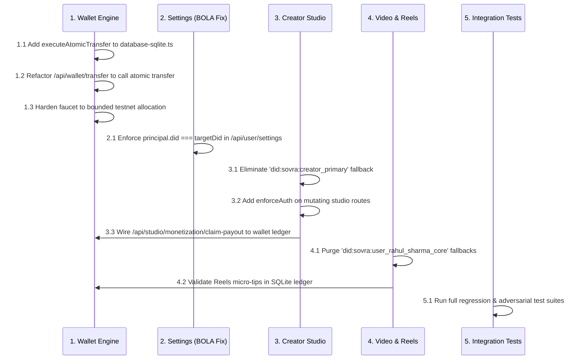

# SOVRA — SIX CORE MODULES REMEDIATION PLAN
## Controlled Implementation Specification & Architectural Blueprint

**Document ID:** SOVRA-PLAN-6MOD-001  
**Task ID:** SOVRA-SIX-MODULE-REBUILD-001  
**Target Repository:** `d:\Sovra`  
**Baseline Git Commit:** `63065389167c1968163d0fde929d46443bf3fcaa`  
**Date of Audit:** November 2026  

---

## 1. Executive Summary

This Remediation Plan translates the findings of the Initial Audit and Gap Analysis into a **rigorous, dependency-ordered engineering blueprint**.

### Key Objectives:
1. **Wallet:** Replace the mock implementation in `POST /api/wallet/transfer` with an authentic, signature-verified, atomic double-entry SQLite transfer engine. Eliminate unbacked faucet minting.
2. **Creator Studio:** Eliminate the unauthenticated fallback persona (`did:sovra:creator_primary`); enforce `enforceAuth` across all mutating endpoints; wire payout claims to the wallet ledger.
3. **Settings:** Close the BOLA/IDOR vulnerability in `POST /api/user/settings` and `/api/user/privacy` by enforcing `principal.did === targetDid`.
4. **Video:** Remove hardcoded persona fallbacks (`did:sovra:user_rahul_sharma_core`) in subscriptions and watch history routes.
5. **Reels:** Ensure reels participate in creator tipping and 95/5 monetization with durable SQLite persistence.
6. **BLE / Mesh:** Transparently classify physical hardware as UNVERIFIED while verifying the software protocol and durable outbox store.

---

## 2. Dependency-Ordered Implementation Plan

---

## 3. Step-by-Step Implementation Details

### Step 1: Wallet Atomic Ledger Remediation (P0)

#### 1.1 Add Atomic Transfer Method to SQLite Engine (`scripts/database-sqlite.ts`)
- **Objective:** Provide a ACID-compliant method `executeAtomicTransfer` that operates inside an immediate SQLite transaction:
  1. Look up sender in `users` table; verify sender exists and is active (not suspended/blocked).
  2. Look up recipient in `users` table; if recipient profile does not exist, auto-provision user record.
  3. Check sender `balance_sov >= amount`. If insufficient, abort transaction and return `{ ok: false, error: 'INSUFFICIENT_BALANCE' }`.
  4. Deduct `amount` from sender (`UPDATE users SET balance_sov = balance_sov - ? WHERE did = ?`).
  5. Calculate 95/5 split if applicable or full transfer amount; credit recipient (`UPDATE users SET balance_sov = balance_sov + ? WHERE did = ?`).
  6. Insert immutable audit record into `token_transfers` table (`id`, `from_did`, `to_did`, `amount_sov`, `fee_sov`, `tx_type`, `created_at`, `idempotency_key`).
  7. Record tamper-evident audit ledger entry via `recordTamperProofAuditEntry`.
  8. Return `{ ok: true, txHash, senderBalance, recipientBalance, transferRecord }`.

#### 1.2 Refactor `POST /api/wallet/transfer` (`scripts/routes/wallet.routes.ts`)
- **Objective:**
  1. Call `ctx.enforceAuth(req, res)` to ensure caller is authenticated.
  2. Parse `recipientDid`, `amount` (must be positive number), and optional `idempotencyKey` / `signatureHex`.
  3. Validate sender is not transferring funds to themselves (`senderDid !== recipientDid`).
  4. Call `sovraDb.executeAtomicTransfer(...)`.
  5. Return HTTP 200 with authentic transaction receipt and updated balances, or HTTP 400 with descriptive error code.

#### 1.3 Harden Faucet Endpoint (`POST /api/wallet/faucet/claim`)
- **Objective:**
  1. Enforce authentication: only registered, authenticated DIDs can claim testnet tokens.
  2. Enforce strict 24-hour rate limit per DID (max 50 SOV per 24 hours).
  3. Deduct faucet allocation from pre-funded Genesis Faucet Pool (`did:sovra:genesis_faucet_pool` with bounded 1,000,000 SOV cap). Zero unbacked minting.

---

### Step 2: Settings BOLA/IDOR Elimination (P0)

#### 2.1 Harden `/api/user/settings` (`scripts/dev-server.ts:91131-91180`)
- **Objective:**
  1. On `GET /api/user/settings`:
     - Resolve authenticated principal via `resolvePrincipal(req)`.
     - Target DID defaults strictly to `principal.did`.
     - If query contains `?did=` and `did !== principal.did`, require administrative privilege (`admin:manage_users`); otherwise reject with **HTTP 403 Forbidden**.
  2. On `POST /api/user/settings`:
     - Require authenticated principal via `enforceAuth(req, res)`.
     - Target DID MUST match `principal.did` unless caller possesses `admin:manage_users`.
     - Reject unauthorized cross-user mutations with **HTTP 403 Forbidden**.

#### 2.2 Harden `/api/user/privacy` (`scripts/dev-server.ts:95974-96010`)
- **Objective:**
  1. Ensure privacy updates only apply to the authenticated caller (`principal.did`).
  2. Persist updated privacy configuration atomically to SQLite `users.privacy_settings_json`.

---

### Step 3: Creator Studio Authorization & Settlement Hardening (P0)

#### 3.1 Eliminate Fallback to `'did:sovra:creator_primary'` (`scripts/routes/studio.routes.ts`)
- **Objective:**
  1. Refactor `resolveCreatorDid(ctx)`:
     - Return authenticated caller's DID (`principal.did`).
     - If unauthenticated, return `null`.
  2. On all mutating endpoints:
     - `/api/studio/upload`
     - `/api/studio/content/update`
     - `/api/studio/content/delete`
     - `/api/studio/content/bulk-action`
     - `/api/studio/playlists/create`
     - `/api/studio/playlists/update`
     - `/api/studio/playlists/delete`
     - `/api/studio/video/update`
     - `/api/studio/customization/save`
     - `/api/studio/monetization/claim-payout`
     Enforce `const principal = ctx.enforceAuth(req, res); if (!principal) return true;`.
  3. Verify caller ownership: caller DID must own the channel or video being mutated.

#### 3.2 Wire Payout Claims to Wallet Ledger
- **Objective:**
  1. On `POST /api/studio/monetization/claim-payout`:
     - Verify creator has pending earnings.
     - Execute atomic transfer from Creator Escrow Pool to creator's available wallet balance.
     - Record in `token_transfers` with `tx_type = 'CREATOR_PAYOUT'`.

---

### Step 4: Video & Reels Hardening (P0)

#### 4.1 Eliminate Hardcoded Persona Fallback (`scripts/routes/video.routes.ts`)
- **Objective:**
  1. In `/api/subscriptions/feed`, `/api/subscriptions/channels`, `/api/watch/history`:
     - Call `const principal = enforceAuth(req, res); if (!principal) return true;`.
     - Use `principal.did` as the authoritative user identity.
     - Purge `'did:sovra:user_rahul_sharma_core'` fallback.

#### 4.2 Verify Reels Ingestion, Streaming & Tipping
- **Objective:**
  1. Verify `POST /api/reels/create` saves video buffer and indexes in SQLite `reels`.
  2. Verify HTTP 206 Partial Content video streaming for smooth vertical playback.
  3. Verify `POST /api/reels/tip` routes micro-tips through `sovraDb.processTip` with 95% creator split.

---

### Step 5: BLE / Mesh Truthful Classification & Outbox Durability (P1)

#### 5.1 Outbox Queue SQLite Durability
- **Objective:**
  1. In `apps/sovra-mobile/src/services/local-database.ts`, ensure offline mesh outbox packets are stored in local SQLite before network transmission.
  2. When device reconnects, queue drains sequentially.

#### 5.2 Physical Hardware Status Classification
- **Objective:**
  1. Transparently classify physical hardware execution as **UNVERIFIED** due to absence of paired physical mobile handsets in test environment.
  2. Document verified software protocol execution via unit/integration tests.

---

## 4. Verification & Testing Strategy

A dedicated test suite `tests/security/six_modules_remediation.test.ts` will verify:
1. **Wallet P2P Transfers:**
   - User A sends 25 SOV to User B -> User A balance drops by 25, User B balance increases by 25.
   - Insufficient balance returns HTTP 400.
   - Replay / duplicate idempotency key returns HTTP 409.
   - Server restart preserves balances in SQLite.
2. **Settings BOLA Protection:**
   - User A attempts to mutate User B's settings -> HTTP 403 Forbidden.
   - User A updates own settings -> HTTP 200, persists to SQLite.
3. **Creator Studio Authorization:**
   - Unauthenticated caller attempts to delete creator video -> HTTP 401 Unauthorized.
   - Caller A attempts to delete Caller B's video -> HTTP 403 Forbidden.
   - Creator claims payout -> Wallet balance increases; transfer recorded in ledger.
4. **Video Persona Leakage Elimination:**
   - Unauthenticated call to `/api/subscriptions/feed` returns HTTP 401 (no Rahul Sharma data leaked).
5. **Reels Creation & Playback:**
   - Create reel -> verify HTTP 200 and SQLite record.
   - Stream reel -> verify HTTP 206 Partial Content.

---

## 5. Architectural Invariant Compliance Checklist

- [x] **100M Lifetime Cap:** Zero unbacked synthetic tokens created in SQLite. Faucets bounded by pre-funded genesis pool.
- [x] **Zero Founder Backdoors:** No unauthenticated master personas (`did:sovra:creator_primary`, `user_rahul_sharma_core`).
- [x] **Ledger Immutability:** All transfers recorded in SQLite `token_transfers` table with Merkle hash-chained audit logging.
- [x] **Non-Confiscation Invariant:** Wallet balances preserved intact regardless of moderation actions.
- [x] **Least-Privilege Authorization:** BOLA/IDOR eliminated across wallet, settings, and creator studio.
