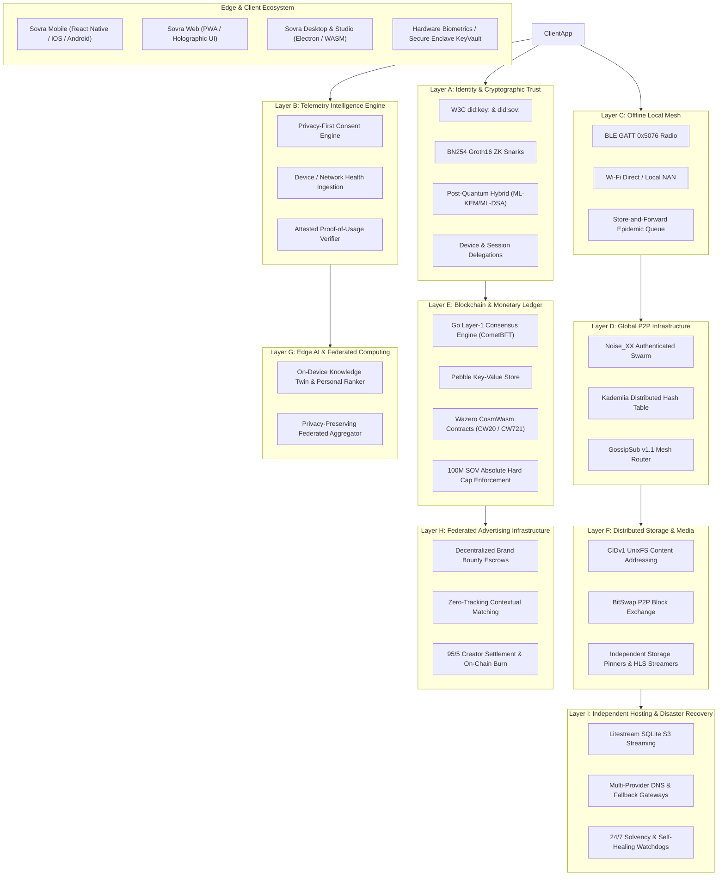

# SOVRA — TARGET TECHNOLOGY ARCHITECTURE
## Next-Generation Multi-Layer Sovereign Ecosystem Specification

**Principal Architect:** Principal Software Architect, Distributed Systems Engineer & Security Auditor  
**Date:** 2026-11-05  
**Version:** 2.0.0-PROPOSAL  
**Standard:** Zero-Trust, Zero Single Point of Failure (SPOF), Decentralized Resilience  

---

### 1. Architectural Vision & Core Axioms

SOVRA is engineered as an anti-fragile, portable, community-hosted digital ecosystem. The architecture guarantees that no single company, cloud provider, government, or infrastructure administrator can permanently compromise, censor, or shut down the network.



---

### 2. Multi-Layer Technical Specification

#### Layer A — Identity and Cryptographic Trust
1. **Cryptographic Identity Model:**
   - Public identity represents W3C `did:key:` derived from Ed25519 public keys (`0xed01` multicodec).
   - Zero-Trust: Private keys never touch application servers. All device actions sign local canonical payloads before wire transmission.
   - Device keys are isolated from master account recovery seeds. Account recovery utilizes Shamir threshold or BIP-39 scrypt-hashed verifiers without universal recovery backdoors.
2. **Access Control & Delegations:**
   - Multi-device authorization operates via signed cryptographic delegation certificates bounded by monotonic expiration and capability scopes (`getRoleCapabilities()`).
   - Admin access requires explicit least-privilege RBAC permission records; all master fallbacks (`did:sov:admin_root`) are eliminated.

#### Layer B — SOVRA Telemetry Intelligence Engine
1. **Unified Schema & Ingestion:**
   - Standardized JSON-LD / Protocol Buffers telemetry event envelope:
     ```typescript
     interface TelemetryPayload {
       eventId: string;
       timestamp: number;
       domain: 'DEVICE' | 'NETWORK' | 'MESH' | 'INFRASTRUCTURE' | 'SECURITY' | 'ECONOMIC';
       consentLevel: 'ESSENTIAL' | 'ANONYMOUS_PERFORMANCE' | 'FULL_DIAGNOSTICS';
       signature?: string; // For economic & proof-of-usage attestation
       metrics: Record<string, number | string>;
     }
     ```
2. **Privacy Guarantees:**
   - Strict segregation between operational diagnostics and user identities.
   - Zero inspection of private messages, call data, or media contents.
   - User opt-in toggles in app settings; local client-side k-anonymity aggregation before transmission.

#### Layer C — BLE and Wi-Fi Offline Network
1. **Physical & Link Layer Separation:**
   - **Discovery & Beacons:** Bluetooth Low Energy (BLE 5.3) GATT Service `0x5076`. Proximity beacons broadcast signed 28-byte frames with rotating HMAC seeds and anti-replay counters.
   - **High-Bandwidth Transfer:** Wi-Fi Direct (P2P Wi-Fi) or Local Network Wi-Fi used for media and large payload synchronization.
2. **Delay-Tolerant Networking (DTN):**
   - Epidemic routing outbox store with cryptographic packet deduplication, time-to-live (TTL) hop counters, and opportunistic gossip upon physical rendezvous.

#### Layer D — Distributed P2P Infrastructure
1. **Secure Transport & Handshake:**
   - Transport independence over TCP, WebSockets, WebRTC DataChannels, and BLE.
   - Mandatory Noise_XX mutual handshake establishing ChaCha20-Poly1305 forward-secret authenticated encryption.
2. **Routing & Swarm Resilience:**
   - Kademlia DHT XOR distance routing with Sybil-resistant dynamic proof-of-work (PoW) node identity ticketing.
   - GossipSub v1.1 mesh peer scoring and automatic malicious peer quarantine.

#### Layer E — Blockchain and SOVRA Economy
1. **Authoritative Ledger Boundary:**
   - The Go-based L1 node (`sovrad`) running CometBFT consensus and Pebble KV storage serves as the single authoritative source of truth for all balances, token transfers, burns, and smart contracts.
   - Application-side SQLite stores serve strictly as indexed read models, local caches, and off-chain transaction staging buffers.
2. **Economic Invariants:**
   - **Lifetime Cap:** Strict 100,000,000 SOV (`100,000,000,000,000 uSOV`).
   - **Emissions Schedule:** 25-year daily epoch recurrence allocation enforcing exact 2:4:1 ratio (Validator:Community:Seeder) down to 1 uSOV.
   - **Deflationary Burns:** Ad spend, storage penalties, and protocol fees trigger permanent verifiable burns that permanently reduce total supply.

#### Layer F — Distributed Storage and Media
1. **Content Addressing & Exchange:**
   - All files, reels, and video segments are addressed by immutable SHA-256 CIDv1 identifiers in UnixFS format.
   - BitSwap block exchange enables peer-to-peer data distribution directly between clients, offloading central servers.
2. **Storage Replication & Availability:**
   - Continuous multi-tier pinning on independent community storage nodes.
   - Transcoding pipeline generates multi-bitrate HLS playlists with chunked fallback to decentralized seeders.

#### Layer G — Edge Computing and Federated AI
1. **Local Processing Architecture:**
   - Client-side inference using WebAssembly (WASM) and ONNX runtime for on-device spam detection, content filtering, and feed ranking.
2. **Privacy-Preserving Federated Intelligence:**
   - Private Knowledge Twin preserves user learning histories locally. Model updates use federated averaging with differential privacy noise injection; raw user interactions are never exported.

#### Layer H — Federated Advertising Infrastructure
1. **B2B Escrows & Attribution:**
   - Advertisers lock campaign budgets into deterministic escrow smart contracts.
   - Creator bounties settle on a 95% creator / 5% platform protocol fee split.
2. **Privacy-First Matching:**
   - Zero tracking cookies. Ad matching is performed client-side based on on-device contextual topics and opt-in interest tags.

#### Layer I — Independent Hosting and Resilience
1. **Infrastructure Multi-Homing:**
   - Support for heterogeneous deployment: VPS, bare metal, home nodes, Docker containers, and Kubernetes.
   - Database portability via Litestream continuous WAL streaming to distributed S3-compatible buckets.
2. **Disaster Recovery & Node Succession:**
   - Cryptographic snapshot verification allowing fresh community nodes to bootstrap to current state in under 60 seconds without data loss.

---

### 3. Cross-Layer Event & Dependency Matrix

```
[Layer A: Identity] ---> Authenticates ---> [Layer C: BLE] & [Layer D: P2P]
[Layer C: BLE]      ---> Ingests to   ---> [Layer B: Telemetry Engine]
[Layer D: P2P]      ---> Transports   ---> [Layer F: Storage BitSwap]
[Layer E: Chain]    ---> Settles      ---> [Layer H: Ad Escrows & Payouts]
[Layer G: Edge AI]  ---> Filters      ---> [Client Application Feed]
[Layer I: Hosting]  ---> Replicates   ---> [All Layer State & SQLite DBs]
```
