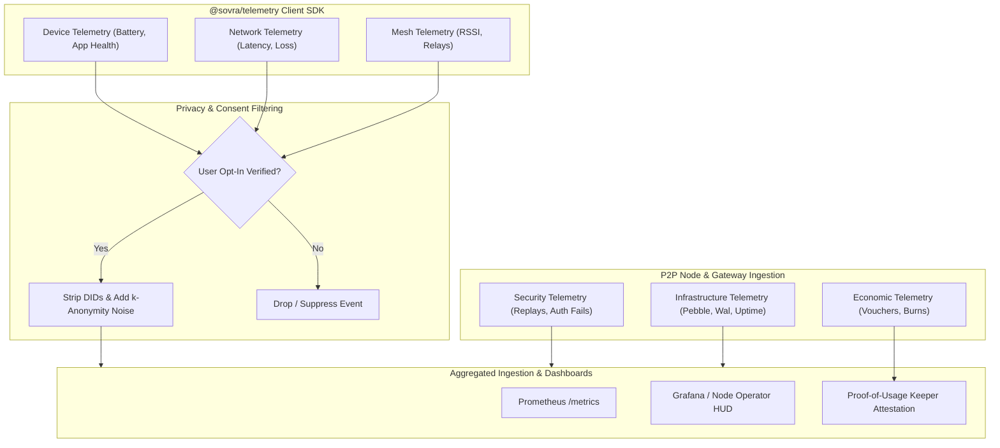

# SOVRA — TELEMETRY SPECIFICATION
## Shared Telemetry Intelligence Engine Specification (Layer B)

**Principal Architect:** Principal Software Architect, Distributed Systems Engineer & Privacy Architect  
**Date:** 2026-11-05  
**Version:** 1.0.0-PROPOSAL  
**Standard:** Privacy-First, Zero-Surveillance, Cryptographically Attested Telemetry  

---

### 1. Architectural Mission & Core Axioms

The SOVRA Telemetry Intelligence Engine is a unified, cross-ecosystem diagnostic substrate engineered to measure network health, device connectivity, mesh propagation, and economic solvency while strictly preserving individual sovereignty and privacy.

**Non-Negotiable Privacy Axioms:**
1. **Zero Inspection of Private Content:** Telemetry streams never inspect or transmit message text, media bytes, recovery phrases, or private keys.
2. **Strict Operational vs. Profiling Segregation:** System telemetry is used exclusively for performance, routing optimization, and fault recovery; it is architecturally barred from advertising profile generation.
3. **Explicit Consent & Granular Toggles:** Users maintain sovereign control over telemetry transmission with local opt-in/opt-out switches.
4. **Client-Side k-Anonymity & Differential Privacy:** Aggregated diagnostics inject mathematical Laplace noise prior to broadcast.

---

### 2. Telemetry Submodules & Event Schemas



#### 2.1 Submodule 1: Device Telemetry
- **Battery Status:** Percentage (0–100) and charging state (`CHARGING` / `DISCHARGING` / `FULL`) where supported by OS APIs. Used to throttle background BLE scanning when battery < 20%.
- **Device Connectivity:** Active transport type (`WIFI` / `CELLULAR_5G` / `CELLULAR_4G` / `BLE_ONLY` / `OFFLINE`).
- **Application Health:** Process uptime, JS heap allocation, memory pressure warning level (`NORMAL` / `MODERATE` / `CRITICAL`).
- **Crash Reporting:** Anonymized stack traces with line numbers, sanitized of paths containing user handles or home directories.

#### 2.2 Submodule 2: Network Telemetry
- **Latency:** Round-trip time (RTT) in milliseconds measured via lightweight P2P ping to 3 nearest DHT peers.
- **Packet Loss:** Percentage of unacknowledged UDP/GATT packets over a rolling 60-second window.
- **Bandwidth Estimates:** Estimated downstream and upstream throughput in bytes/second.
- **API Availability:** HTTP status response distribution and endpoint error ratios.

#### 2.3 Submodule 3: Mesh Telemetry
- **Nearby Participating Nodes:** Count of discovered BLE peers broadcasting valid signed beacons (`0x5076`).
- **BLE Signal Strength:** Filtered RSSI (dBm) and calculated distance in meters via Log-Distance Path Loss.
- **Relay Success Rate:** Percentage of DTN store-and-forward packets successfully delivered across peers.
- **Offline Outbox Status:** Number of queued packets waiting for physical rendezvous or internet reconnection.

#### 2.4 Submodule 4: Infrastructure Telemetry
- **Node Health:** CometBFT block height, peer counts, and consensus voting round durations.
- **Storage Availability:** Free disk space on storage nodes, BitSwap block transfer throughput, and pinning counts.
- **Pebble / SQLite Performance:** WAL checkpoint duration, active frame counts, and cache hit ratios.

#### 2.5 Submodule 5: Security Telemetry
- **Authentication Failures:** Monitored per IP/Subnet with exponential backoff triggering durable lockout records.
- **Replay Protection Hits:** Frequency of duplicate nonce submissions or timestamp skew > 300s.
- **Sybil Detection:** Distribution of peer node IDs in Kademlia buckets and dynamic PoW difficulty adherence.

#### 2.6 Submodule 6: Economic Telemetry
- **Verified Usage Measurements:** Cryptographically signed Seeder Vouchers submitted by receiving peers for BitSwap blocks.
- **Settlement Reconciliation:** Comparison between off-chain voucher claims and L1 blockchain mint reserves.
- **Supply & Burn Monitoring:** Real-time tracking of 100,000,000 SOV ceiling and cumulative permanent burn transactions.

---

### 3. Unified Wire Schema (Protocol Buffer / JSON-LD)

```typescript
export interface SovraTelemetryEvent {
  // Envelope metadata
  eventId: string;
  version: '1.0.0';
  timestamp: number;
  domain: 'DEVICE' | 'NETWORK' | 'MESH' | 'INFRASTRUCTURE' | 'SECURITY' | 'ECONOMIC';

  // Consent & privacy metadata
  consentLevel: 'ESSENTIAL' | 'ANONYMOUS_METRICS' | 'FULL_DIAGNOSTICS';
  kAnonymityBucket?: string;

  // Domain payloads
  metrics: {
    batteryPct?: number;
    rttMs?: number;
    packetLossPct?: number;
    discoveredPeersCount?: number;
    meanRssiDbm?: number;
    dtnQueueDepth?: number;
    walCheckpointMs?: number;
    authFailuresCount?: number;
    burnedUsov?: string;
  };

  // Cryptographic attestation (strictly for economic Proof-of-Usage)
  attestationSignature?: string;
  attestationPublicKey?: string;
}
```

---

### 4. User Consent, Data Retention & Bounding

1. **User Control Settings:**
   - In `apps/sovra-mobile` and `apps/sovra-app`, the Me/Settings tab provides a **Diagnostics & Telemetry** surface with options:
     - `OFF`: Only essential local health data; zero outbound telemetry.
     - `ANONYMOUS_PERFORMANCE` (Default): Latency, packet loss, and BLE mesh diagnostics aggregated without user identifier.
     - `FULL_DIAGNOSTICS`: Includes battery status and crash reports to aid network development.
2. **Storage Bounding & Auto-Pruning:**
   - Raw telemetry events on nodes are subject to a strict 14-day Time-to-Live (TTL).
   - Rollup aggregates (1-hour and 24-hour mean/p99) are stored in SQLite; raw entries are purged automatically every 24 hours.
