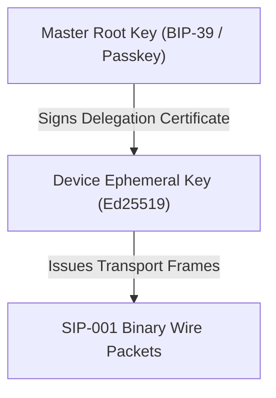

# SIP-002: Decentralized Identity (DID), Ed25519 Delegation & Hashcash Anti-Sybil Engine

- **SIP Number:** 002
- **Title:** Sovereign Decentralized Identity (DID), Device Delegation, and Anti-Sybil Proof-of-Work
- **Author:** Sovra Protocol Architecture Council
- **Status:** Standard / Active
- **Type:** Standards Track (Core / Identity & Security)
- **Created:** 2026-10-14
- **Updated:** 2026-11-19

---

## 1. Abstract

SIP-002 standardizes the self-sovereign identity architecture, cryptographic key derivation, passkey delegation, and Hashcash-based anti-spam/anti-Sybil mechanism for the Sovra decentralized protocol. Users own their master cryptographic credentials without relying on centralized identity providers, phone numbers, or corporate servers.

---

## 2. Decentralized Identifier (DID) Architecture

Sovra identities utilize the W3C DID specification using the `did:sovra` method identifier:

```
did:sovra:<encoded_public_key>
```

### 2.1 Key Derivation
1. **Master Root Key**: Generated via BIP-39 12- or 24-word mnemonic seed phrase over derivation path `m/44'/607'/0'/0/0` using Ed25519 (Edwards-curve Digital Signature Algorithm).
2. **WebAuthn / Passkey Representation**: Client devices (browsers, iOS Secure Enclave, Android StrongBox) generate hardware-bound credentials mapped to canonical DIDs: `did:sovra:user:<multibase_key_id>`.

---

## 3. Cryptographic Device Delegation

To prevent root private keys from ever being exposed to web views or transient network workers, Sovra implements a two-tier delegation architecture:



### 3.1 Delegation Certificate Envelope
A valid `PeerIdentityBinding` includes:
```json
{
  "masterDid": "did:sovra:z6MkuT...",
  "deviceKeyId": "dev-local-primary",
  "devicePubKey": "0x38bdf8...",
  "permissions": ["GOSSIP_POST", "CHAT_WRITE", "CALL_SIGNAL", "STORAGE_PIN"],
  "expiresAt": 1893456000,
  "masterSignature": "ed25519_sig_..."
}
```

---

## 4. Hashcash Proof-of-Work Anti-Sybil Engine

To guarantee zero-cost spam resistance on open GossipSub mesh topics without central moderation, every public social mutation (post, comment, reaction, channel dispatch) MUST solve a Hashcash Proof-of-Work challenge.

### 4.1 Proof-of-Work Verification Algorithm

```text
Target Hash = SHA-256( SHA-256( EventID || BigEndian64(Nonce) ) )
Condition: LeadingZeroBits(Target Hash) >= RequiredDifficulty
```

### 4.2 Dynamic Difficulty Requirements

| Operation Type | Minimum Difficulty (Zero Bits) | Average Hash Iterations | Computation Time (Modern Mobile) |
| :--- | :--- | :--- | :--- |
| **Reaction / Like** | 12 Bits | 4,096 Hashes | ~5 ms |
| **Feed Comment** | 14 Bits | 16,384 Hashes | ~20 ms |
| **Root Feed Post** | 16 Bits | 65,536 Hashes | ~80 ms |
| **Creator Broadcast Media** | 20 Bits | 1,048,576 Hashes | ~1.2 s |

Any incoming GossipSub frame failing the minimum difficulty threshold is dropped immediately at the network ingress boundary before reaching local storage.

---

## 5. Security Properties

1. **Zero Central Authorization**: Identity creation is an offline, local operation requiring no network round-trips.
2. **Mathematical Rate-Limiting**: A spammer attempting to flood the network with 1,000 posts per second would require massive ASIC/GPU computational clusters, rendering spam attacks economically unviable.
3. **PQC Evolution Path**: The DID and delegation structures support hybrid Kyber/Dilithium post-quantum keys via multicodec prefixes (`0x1200` Ed25519, `0x1201` ML-DSA-65).

---

## 6. Implementation Reference
- Identity & Keyring: `packages/identity/src/`
- Proof-of-Work Verifier: `packages/p2p/src/sybil-pow.ts`
- Zero-Trust Client Verification: `scripts/views/scripts.view.ts`
- Automated Test Suite: `tests/unit/client-zerotrust-verification.test.ts`
