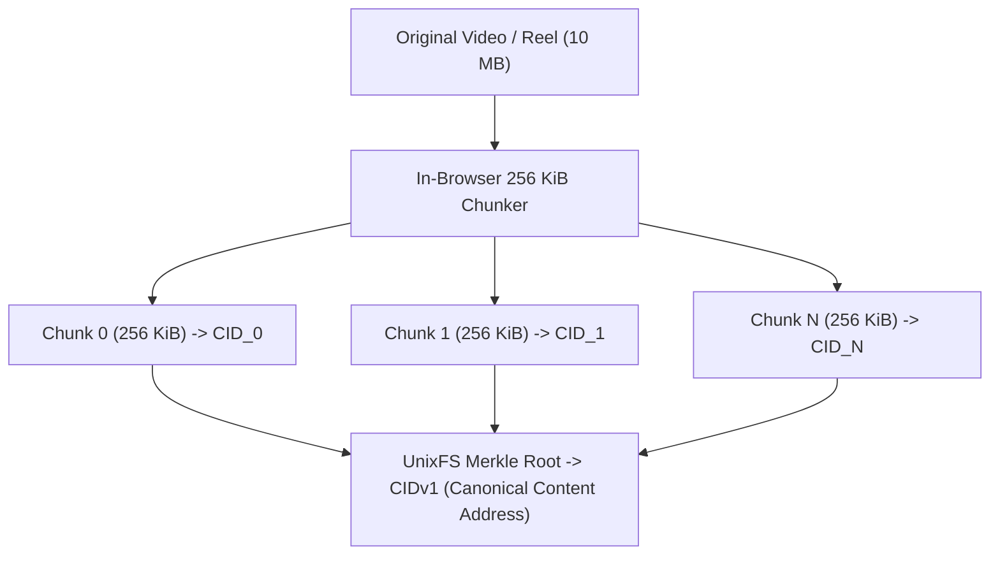

# SIP-003: BitSwap UnixFS Media CDN & Tit-for-Tat Swarm Choking Engine

- **SIP Number:** 003
- **Title:** In-Browser UnixFS 256 KiB Media Chunking, Merkle DAG CIDv1, and Tit-for-Tat Swarm Choking
- **Author:** Sovra Protocol Architecture Council
- **Status:** Standard / Active
- **Type:** Standards Track (Storage / P2P CDN)
- **Created:** 2026-10-14
- **Updated:** 2026-11-19

---

## 1. Abstract

SIP-003 standardizes the decentralized media storage and peer-to-peer content distribution architecture of Sovra. It replaces centralized media upload servers with client-side 256 KiB UnixFS chunking, Merkle DAG CIDv1 generation, and peer-to-peer piece exchange governed by BitTorrent's Tit-for-Tat game-theoretic choking algorithm over WebRTC DataChannels.

---

## 2. In-Browser Media Ingestion & Merkle DAG Construction

When a client attaches a photo, reel, video, or document to any post or message, the file is processed locally without uploading the full binary to any server.

### 2.1 Chunking Parameters
* **Block Size**: Exactly $262,144\text{ Bytes}$ ($256\text{ KiB}$).
* **Hashing Algorithm**: Cryptographic SHA-256 ($32\text{ Bytes}$).
* **Multicodec**:
  * Leaf Chunk: `0x55` (`raw`)
  * Inner / Root DAG Node: `0x70` (`dag-pb`)
* **Multibase**: `b` (`base32` lowercase RFC 4648).

### 2.2 Canonical CIDv1 Format
A canonical Sovra media identifier has the form:
`bafybeic...` or `bafkrei...`
calculated via WebCrypto `SubtleCrypto.digest('SHA-256', block)`.

---

## 3. WebRTC DataChannel BitSwap Transport

Peers exchange blocks directly over WebRTC DataChannels using SIP-001 framed messages:
* `OpCode 0x0040`: `BITSWAP_WANTLIST` - Array of CIDs prioritized by playback position.
* `OpCode 0x0041`: `BITSWAP_BLOCK` - Length-prefixed block payload matching requested CID.

---

## 4. Tit-for-Tat Game-Theoretic Choking Engine

To prevent free-riding (peers consuming bandwidth without seeding content), every Sovra node implements a variant of Bram Cohen's BitTorrent Tit-for-Tat algorithm.

### 4.1 Swarm States
For every connected peer $P$, the node maintains two independent states:
1. `amChoking`: Whether this node refuses to send blocks to $P$.
2. `peerChoking`: Whether peer $P$ refuses to send blocks to this node.

### 4.2 Slot Allocation & Round-Robin Evaluation
Every $10\text{ seconds}$, the node ranks all active peers by their rolling $20\text{-second}$ download throughput:
1. **Regular Unchoke Slots (4 Peers)**: The top 4 seeders providing the highest transfer rate are unchoked (`amChoking = false`).
2. **Optimistic Unchoke Slot (1 Peer)**: One random peer is unchoked regardless of download rate every $30\text{ seconds}$ to discover newly joining peers and potential high-speed seeders.
3. **Choking Free-Riders**: All remaining peers are dynamically choked (`amChoking = true`), receiving zero block data until they contribute upstream bandwidth.

---

## 5. Offline & P2P Streaming Fallback Hierarchy

When a client player renders a video or reel:
1. **P2P Swarm First**: The player requests chunks over WebRTC DataChannels from DHT-discovered peers.
2. **Browser OPFS / Cache**: Chunks are verified against SHA-256 hashes and cached in IndexedDB / Origin Private File System.
3. **HTTP Seed Fallback**: If no swarm peer possesses chunk $K$ within $1,500\text{ ms}$, the player requests that specific chunk from bootstrap archive seeders.

---

## 6. Implementation Reference
- Browser UnixFS Chunker: `tests/unit/unixfs-inbrowser-chunker.test.ts`
- BitSwap Tit-for-Tat Adapter: `packages/storage/src/webrtc-bitswap.ts`
- Storage Daemon: `packages/storage/src/node.ts`
- Unit Test Suite: `packages/storage/test/webrtc-bitswap.test.ts`
