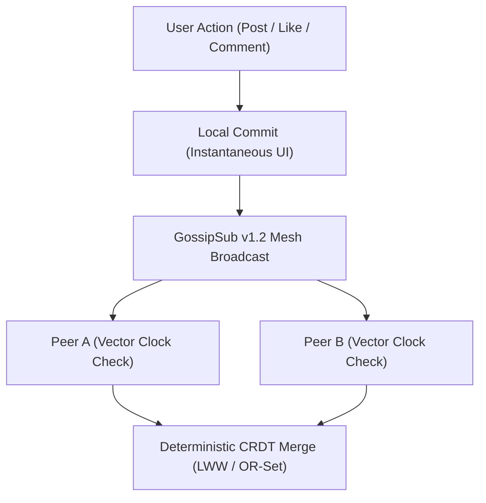

# SIP-004: Distributed Social State Mesh, Vector Clocks & Anti-Entropy Synchronization

- **SIP Number:** 004
- **Title:** Distributed Social State Mesh, CRDTs, Vector Clocks, and Anti-Entropy Synchronization
- **Author:** Sovra Protocol Architecture Council
- **Status:** Standard / Active
- **Type:** Standards Track (Core / State Replication)
- **Created:** 2026-10-14
- **Updated:** 2026-11-19

---

## 1. Abstract

SIP-004 defines the distributed consensus and eventual consistency model for Sovra's social state layer (posts, comments, emoji reactions, friend graphs, and creator profiles). Operating independently of financial blockchain blocks, the social state replicates across P2P GossipSub mesh networks using Conflict-Free Replicated Data Types (CRDTs), vector clocks, and Initial Feed Sync (Anti-Entropy) handshakes.

---

## 2. Social State vs Financial State Separation

In Sovra's architecture:
1. **Financial Layer (Layer 1)**: CometBFT Tendermint PoS consensus strictly manages high-value economic state (SOV token balances, handle reservations, smart contracts) requiring global total ordering.
2. **Social Layer (Mesh Layer)**: P2P GossipSub with CRDT semantics manages social interactions requiring partition tolerance and instantaneous offline-first local commits.



---

## 3. Conflict-Free Replicated Data Types (CRDTs)

Every social entity is modeled as a mathematically provable CRDT:

### 3.1 Post Content & Profiles: Last-Write-Wins Element-Set (LWW-Element-Set)
* Concurrent edits to a post caption or profile bio resolve deterministically by comparing `(wall_clock_ms, author_signature_hash)`.
* Ties are broken by highest cryptographic hash of the digital signature.

### 3.2 Post Reactions & Likes: Positive-Negative Counter (PN-Counter)
* Each peer maintains a positive register $P$ (likes) and negative register $N$ (unlikes) per DID.
* State value $= \sum P - \sum N$. Commutative and idempotent across network partitions.

### 3.3 Friend Relationships & Follower Graphs: Observed-Removed Set (OR-Set)
* Friend connections assign unique monotonic operation IDs (`freq-...`).
* Concurrent acceptance and removal operations merge deterministically without phantom revive anomalies.

---

## 4. Anti-Entropy Initial Feed Sync Handshake

When a new node joins the network or reconnects after being offline, it MUST execute an anti-entropy catch-up protocol (analogous to Bitcoin's Initial Block Download):

```
Node B (New Peer)                           Node A (Active Seeder)
      |                                              |
      | -------- FEED_SYNC_REQUEST(since, 50) ------> |
      |                                              |
      | <------- FEED_SYNC_RESPONSE(posts[], DAGs) - |
      |                                              |
   [Verify Signatures & PoW]
   [Reconcile Local SQLite & Feed]
```

### 4.1 Handshake Messages
1. **`FEED_SYNC_REQUEST`**:
   ```json
   {
     "type": "FEED_SYNC_REQUEST",
     "requesterPeerId": "12D3KooW...",
     "requesterDid": "did:sovra:...",
     "sinceTimestamp": 1731900000000,
     "limit": 50
   }
   ```
2. **`FEED_SYNC_RESPONSE`**:
   ```json
   {
     "type": "FEED_SYNC_RESPONSE",
     "requesterPeerId": "12D3KooW...",
     "posts": [ ... ],
     "timestamp": 1731980000000
   }
   ```

---

## 5. GossipSub Mesh Topic Topology

All nodes subscribe to canonical hierarchical topics:
* `sovra/feed/main`: Root social events, comments, replies, and reactions.
* `sovra/social/friends`: Bilateral friend handshakes and status confirmations.
* `sovra/social/graph/v1`: Directed follower graph operations.
* `/sovra/v1/chat/direct`: Cross-node end-to-end encrypted messaging.
* `/sovra/v1/signal/{recipientDid}`: Dynamic WebRTC signaling channels.

---

## 6. Implementation Reference
- Vector Clock & CRDT Engine: `packages/protocol/src/vector-clock.ts`
- Distributed Mesh State: `packages/protocol/src/distributed-state.ts`
- Dev Server Subscription & Anti-Entropy: `scripts/dev-server.ts:852`
- Test Suite: `tests/integration/multi-node-convergence.test.ts`
